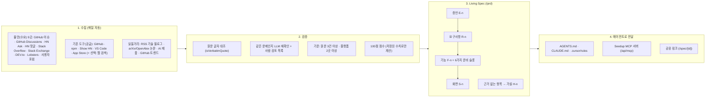

<div align="center">

# 🌱 Seedup

**개발자들이 공개 글에 남긴 실제 불만을 원문과 글자 단위로 대조해 모으고,**  
**그 원문을 근거로 한 PRD(Living Spec)와 코딩 에이전트 지침(`AGENTS.md` · MCP)까지 한 흐름으로 이어 주는 서비스**

[](https://seedup.rerereally.com)
[](https://nextjs.org/)
[](https://react.dev/)
[](https://supabase.com/)
[](https://modelcontextprotocol.io/)

</div>

---

## 👥 참여 인원 (Team)

| 이름 | 역할 및 담당 |
| :---: | :--- |
| **정지훈** | 프로젝트 총괄 설계 · 기회 엔진 & Living Spec(`E→R→F→S`) · RAG/추천 파이프라인 · MCP 서버 · 풀스택 개발 |
| **장차희** | 서비스 기획 · 데이터 검증 및 큐레이션 설계 · UI/UX 개편(소개 페이지, 앱 셸, PRD 작업 화면) · 품질 테스트 |

---

## 💡 왜 Seedup을 만들었는가? (Why Seedup?)

> *"코딩 에이전트(Cursor, Claude Code) 덕분에 **'어떻게 만들까'**는 10배 빨라졌습니다. 그런데 **'무엇을, 왜 만들어야 하는가'**에는 여전히 근거가 없습니다. LLM에게 물으면 무조건 좋은 아이디어라고 맞장구치거나(Sycophancy), 있지도 않은 근거를 지어냅니다(Hallucination). 그래서 **실제 개발자가 공개 글에 남긴 불만에서 출발해, 그 원문을 PRD와 에이전트 지침까지 끊기지 않게 전달하는 도구**를 만들었습니다."*

### 기존 서비스와 다른 점

| 비교 영역 | 뉴스레터 · 트렌드 서비스 | AI PRD · 아이디어 생성 도구 | **🌱 Seedup** |
| :--- | :--- | :--- | :--- |
| **근거** | 요약은 주지만 원문 근거는 약함 | 짧은 프롬프트만 보고 그럴듯한 PRD 생성 | LLM이 뽑은 인용이 **원문에 글자 그대로 있을 때만** 채택(`isVerbatimQuote`). 증언 근거가 없는 요구사항은 서버가 **가설(H-n)**로 따로 둠 |
| **시장 확인** | 경쟁 상황 분석 없음 | 이미 같은 도구가 있어도 칭찬함 | GitHub · npm · Show HN · VS Code · App Store에서 기존 도구를 찾아 **직접 경쟁 수**와 시장 상태(`open` / `narrowing` / `closed`)를 표시 |
| **코딩 연결** | 읽기에서 끝남 | 마크다운 한 장으로 끝남 | `증언(E) → 요구사항(R) → 기능(F) → 화면(S)` 추적, 6가지 개발 준비 슬롯, `AGENTS.md` / `CLAUDE.md` / `.cursor/rules` 내보내기, **MCP 서버로 에이전트가 직접 가져감** |
| **기존 프로젝트** | 지원 안 함 | 새 아이템만 다룸 | 내 GitHub 저장소를 분석해 **다음 기능 3가지와 역기획 스펙**을 제안(`/seeds`) |

---

## 🏗️ 아키텍처 & 근거 추적 파이프라인



---

## 🚀 주요 기능

### 1. 홈 (`/`)
- **아이디어 한 줄 입력:** 입력하면 그 아이디어와 가까운 실제 원문을 바로 보여 주고, PRD 작업 화면으로 이어집니다.
- **소개 섹션:** 원문이 흐르는 띠, 원문 → PRD → 에이전트 단계 설명, 불만이 먼저 나오고 도구가 나중에 나온 기록 차트.
- **로그인 후 작업대:** 시작 체크리스트(관심 분야 → 첫 PRD → 에이전트 연결), 최근 PRD, 맞춤 추천, 킵한 저장소의 새 릴리스.

### 2. 인사이트: 검증된 문제 목록 (`/newsletter-preview`, `/opportunities/[slug]`)
- 주간 호와 함께 기준을 통과한 문제와 아직 모으는 중인 문제를 보여 줍니다. (`/opportunities`는 이 목록으로 이동합니다.)
- **문제 상세:**
  - 원문(영어 원문 · 한국어 번역 · 원문 링크)
  - **점수 내역 100점:** 원문 수 30 · 플랫폼 폭 20 · 반응 15 · 최근성 15 · 남은 빈틈 20. AI가 매긴 점수가 아니라 저장된 수치로만 계산합니다.
  - 왜 지금인가, 성장 기록, 이미 있는 도구
  - 혼자 만들 때의 규모 추정, **첫 10명 찾기**(원문 작성자가 있는 곳, 만나면 물어볼 것, 링크 없는 답글 초안)
- **사람 검토 목록(`lib/opportunities/review.ts`):** 원문이 글자 그대로 맞아도 다른 이야기를 하는 인용은 빼고, 엔진 규칙상 걸러졌어야 할 문제(한 제품의 기능 요청 등)는 숨깁니다. 사이트 · MCP · 메일에 한 번에 적용됩니다.

### 3. 근거 추적 PRD 작업 화면 (`/prd`, `/prd/new`, `/spec/[id]`)
- **아이디어에 맞춘 질문:** 아이디어와 가까운 원문을 보고, PRD를 바꾸는 결정(첫 사용자, 쓰는 순간, 첫 버전의 한 가지, 플랫폼, 성공 기준, 제약)만 객관식 3~5개로 묻습니다(`lib/opportunities/questions.ts`). 모델이 답하지 않으면 고정 질문으로 바뀝니다.
- **쓰는 대로 보이는 PRD:** 모델이 마크다운 문서(배경, 대상, 사용 장면, 목표, 요구사항과 수락 기준, 기능, 위험, 가정, 지표, 열린 질문)를 쓰는 대로 화면에 흘려 보내고(`streamText`, NDJSON), 끝나면 그 문서를 구조로 읽어 근거 검사를 거칩니다(`prd-markdown.ts`, `normalizeSpec()`). 지시문과 모범 예시는 `prd-prompt.ts`에 있고, 바꿀 때는 `scripts/eval-prd.ts`와 `scripts/judge-prd.ts`로 전후를 잽니다.
- **근거가 없을 때:** 기준 미달이면 웹 원문 찾기를 먼저 자동으로 돌리고, 그래도 없으면 가설마다 누구에게 무엇을 물어 확인할지 씁니다. 지켜보기, 소개 페이지, 직접 들은 말(인터뷰·메모, 기준에는 안 셈)로 이어집니다.
- **`E-n → R-n → F-n → S-n` 추적:** 모든 요구사항은 증언을, 기능은 요구사항을, 화면은 기능을 참조해야 하며 서버(`normalizeSpec()`)가 강제합니다. 증언 근거가 없는 요구사항은 **가설(H-n)**로, 기준 미달 문제로 만든 PRD는 **가설 초안**으로 표시합니다.
- **5가지 보기:** 문서 · 기능 명세(근거 추적) · 유저플로우 · 와이어프레임 · 구조 트리. 항목을 누르면 연결된 원문과 상하위 항목이 함께 강조됩니다(`traceOf`).
- **6가지 개발 준비 슬롯**(기능마다): 입력·상태 조건, 비즈니스 규칙, 예외·오류 처리, 권한, 데이터, 완료 기준. 정해지지 않은 항목은 에이전트가 먼저 묻도록 적습니다.
- **대화형 수정과 버전 기록:** 원문 목록은 고정한 채 자연어로 고치거나 항목 하나만 고치고, 고칠 때마다 버전과 바뀐 줄을 남깁니다. 버전은 이 브라우저에 남아 새로고침해도 이어집니다.
- **근거 직접 추가:** 글 링크를 붙이면 Seedup이 그 글을 읽어 글자 단위로 맞는 문장만 원문으로 담습니다. 크롬 확장으로 담은 문장도 여기 나옵니다.
- **내보내기와 공유:** `AGENTS.md` · `CLAUDE.md` · `.cursor/rules`, Lovable · Bolt · v0용 첫 프롬프트, PRD 마크다운, Mermaid 코드 복사. 보관함에서 읽기 전용 공개 링크(`/spec/[id]`)를 켜고, 만든 결과물 링크(“만들었어요”)를 붙일 수 있습니다.

### 4. 아이디어 검증 (`/ideas`)
- **검증 리포트(하루 3건):** 아이디어 하나에 대해 실제 원문, 기존 도구, 첫 사용자 후보, 판정을 한 장으로 줍니다.
- **AI 평가:** pgvector 하이브리드 RAG로 관련 뉴스 · 논문 · 오픈소스 · AI 제품 근거를 찾아 점수를 매기고, 사용자가 말한 것(`user_stated`)과 AI가 추정한 것(`inferred_assumptions`)을 나눠 보여 줍니다.
- **지켜보기:** 아이디어를 등록하면 매주 새 원문과 새 경쟁 도구를 메일로 알려 줍니다(최대 10개).
- **검증 실험 키트(`/try/[slug]`):** 아이디어 소개 공개 페이지와 대기자 명단, CSV 내려받기. 프로필에서 관리합니다.

### 5. MCP 연동 (`/agents`)
- **버튼 한 번 연결:** 'Cursor에 연결', 'VS Code에 연결', 'Claude Code 명령 복사'로 토큰 발급과 연결을 한 번에 합니다. 토큰(`sdp_...`)은 DB에 SHA-256 해시로만 저장합니다.
- **표준 Streamable HTTP JSON-RPC 2.0 서버(`lib/mcp/server.ts`)**, 도구 9개:

| 도구 | 하는 일 |
| :--- | :--- |
| `search_opportunities` | 검증된 문제를 키워드로 검색 |
| `get_opportunity` | 문제 · 빈틈 · 원문(`E-n`) · 경쟁 도구 상세 |
| `generate_verified_prd` | 근거 추적 PRD를 `AGENTS.md` 등 원하는 형식으로 생성(하루 10회, 같은 근거면 캐시) |
| `get_build_checklist` | PRD 기능(`F-n`)별 완료 기준과 완료 여부 |
| `mark_feature_done` | 기능의 수락 기준마다 통과한 확인(테스트나 명령과 결과)을 받아야 완료로 표시(사이트 PRD에 반영) |
| `get_kept_items` | 보관함에 킵한 저장소 · 아티클 · 논문 · 제품 |
| `find_related_content` | 아이디어와 의미가 가까운 뉴스 · 논문 · 저장소 · 제품 |
| `validate_idea` | 아이디어 검증 리포트(하루 3회) |
| `watch_idea` | 아이디어 지켜보기 등록(최대 10개) |

### 6. 레포 분석 (`/seeds`)
- GitHub 계정의 최근 공개 저장소(포크 제외)를 README · 언어 · 토픽으로 분석해 가까운 문제, 관련 아티클, 비슷한 오픈소스를 연결합니다.
- **다음 기능 3가지 제안:** 저장소의 `issues/new`를 제목과 본문이 채워진 상태로 바로 엽니다.
- **역기획(Reverse Spec):** README, 상위 2단계 파일 트리, `package.json` / `pyproject.toml`을 읽어 **깨면 안 되는 기존 구조**를 지키며 새 기능 스펙을 만듭니다.
- arXiv + OpenAlex 논문 최대 3편 추천.

### 7. 아티클 · 트렌드 (`/news`, `/papers/[id]`, `/trends`, `/github-trends`, `/ai-products`)
- 트랙별 데일리 아티클(원문 3개 이상, 소스 종류 2개 이상 모인 묶음만 발행)과 문장별 출처 구분(원문 근거 / 추론 / 배경지식).
- 글 · 논문 상세 오른쪽의 **글 도우미 챗봇**(`POST /api/articles/ask`).
- GitHub 급상승 저장소, AI 제품 레이더(별점 · 리뷰), 모델 리더보드.

### 8. 알림 · 개인화
- **맞춤 추천(`lib/recommendations.ts`):** 온보딩 관심사 + 킵 · 좋아요 · 싫어요 · 관심 없음 + 신선도. 임베딩이 없어도 규칙 기반으로 동작합니다.
- **메일:** 주간 뉴스레터와 기회 변동 다이제스트(Resend, 수신자별 실패 격리, `newsletter_sends` + `Idempotency-Key`로 중복 발송 방지). 지난 호는 웹(`/newsletter-preview/[period]`)에 쌓입니다.
- **디스코드 · 슬랙 웹훅:** 주간 신호와 변경 알림을 채팅 채널로 보냅니다.

### 9. 크롬 확장 (`extension/`)
- GitHub · Hacker News · Stack Overflow에서 문장을 고르고 오른쪽 클릭 → **Seedup에 원문으로 담기**. Seedup이 원문을 다시 읽어 글자 그대로 있는지 확인한 뒤 PRD 근거로 보관합니다(하루 60개). 설치 방법은 [extension/README.md](extension/README.md).

### 10. 관리자 (`/admin/ingest`)
- 수집 단계별 실행과 성공/실패, 임베딩 백필, 다이제스트 미리보기와 발송, 소스별 승인율과 품질 미달 기록(`ingest_rejections`).
- 사용 지표(PRD 성공률과 걸린 시간 포함)와 DB 변경 적용 여부 점검.

---

## 📊 현재 상태와 한계 (2026-11-18 기준)

숨기지 않고 적습니다.

| 항목 | 지금 상태 |
| :--- | :--- |
| 공개 중인 문제 | **25개, 그중 기준(원문 3건 · 플랫폼 2곳) 통과 6개.** 기준은 일부러 엄격하게 두고, 통과 수는 수집을 늘려서 키웁니다 |
| 원문 검증의 한계 | 글자 대조는 "그 문장이 원문에 있다"만 보장하고 "그 문제와 관련 있다"는 보장하지 않습니다. 그래서 LLM 재확인과 사람 검토 목록을 둡니다 |
| 무료 모델 | 엔진은 무료 OpenRouter 모델로 매일 돌고, 한 번에 14~29분이 걸리며 일부 호출이 실패합니다. 실패하면 이전 결과를 유지하고, 사용 횟수는 돌려줍니다 |
| 수요로 섞이는 글 | 제품을 만든 사람의 소개 글("I built this…")이 불만 원문으로 들어오는 경우가 있습니다 |
| 선행 기록 | "불만이 먼저 나오고 도구가 나중에 나왔다"는 기록은 참고용입니다. 인과관계를 뜻하지 않습니다 |
| 영어 | 홈 · 문제 · PRD 등 주요 화면만 영어를 지원합니다 |
| 사용자 검증 | 실사용자 테스트를 준비 중입니다([docs/user-interview.md](docs/user-interview.md)) |

더 자세한 진단과 계획은 [docs/service-plan.md](docs/service-plan.md)에 있습니다.

---

## 🛠️ 기술 스택

| 영역 | 사용 기술 |
| :--- | :--- |
| **Frontend** | Next.js 16 (App Router), React 19, TypeScript, Tailwind CSS 4, Lucide React |
| **Backend & DB** | Supabase PostgreSQL, Row Level Security, `pgvector` (1536차원) |
| **인증** | Supabase Auth (Google · GitHub OAuth), SHA-256 해시 개인 MCP 토큰 |
| **AI** | OpenRouter (생성 · 추출 · 검증 · 역기획). 임베딩 기본값 `nvidia/nemotron-3-embed-1b:free`(2048차원을 앞 1536차원으로 잘라 다시 정규화) |
| **수집** | `rss-parser`, GitHub REST · GraphQL, Hacker News Algolia, Stack Exchange, DEV.to, Lobsters, Discourse 포럼, npm, VS Code Marketplace, App Store, arXiv, OpenAlex, 선택: Tavily 웹 검색 |
| **에이전트 연동** | MCP (Streamable HTTP JSON-RPC 2.0), `AGENTS.md` / `CLAUDE.md` / `.cursor/rules` |
| **메일 · 예약 작업** | Resend, GitHub Actions 예약 워크플로 |
| **배포** | Cloudflare Workers, `@opennextjs/cloudflare` |

---

## ⚡ 빠른 시작

### 1. 사전 요구사항
- **Node.js** 20.9 이상 / **npm** 10 이상
- **Supabase** 프로젝트(`pgvector` 확장 활성화)
- **OpenRouter** API 키
- *(선택)* GitHub 토큰, Google/GitHub OAuth 클라이언트, Resend API 키, Tavily API 키

### 2. 설치

```bash
git clone https://github.com/rerereally/Seedup_ver2.git
cd Seedup_ver2
npm install
cp .env.example .env
```

### 3. 환경변수 (`.env`)

필수 값입니다. 전체 목록과 설명은 [.env.example](.env.example)에 있습니다. 실제 키는 `.env`에만 넣고 `.env.example`에는 넣지 않습니다.

```env
# Supabase
NEXT_PUBLIC_SUPABASE_URL=https://your-project.supabase.co
NEXT_PUBLIC_SUPABASE_PUBLISHABLE_KEY=sb_publishable_your-key
SUPABASE_SECRET_KEY=sb_secret_your-key

# OpenRouter (LLM & 임베딩)
OPENROUTER_API_KEY=your-openrouter-api-key
OPENROUTER_MODEL=nvidia/nemotron-3.5-super-vl:free
OPENROUTER_FALLBACK_MODELS=recursive/flint-v1.0:free,openrouter/free
OPENROUTER_FREE_ONLY=true
RAG_EMBEDDING_MODEL=nvidia/nemotron-3-embed-1b:free

# 사이트 & 관리자
NEXT_PUBLIC_SITE_URL=http://localhost:3000
INGEST_SECRET=change-this-secret
ADMIN_EMAILS=you@example.com
```

<details>
<summary><b>선택 환경변수 (GitHub, 메일, 웹 검색, 수집 옵션)</b></summary>

```env
GITHUB_TOKEN=your-github-token
GITHUB_MIN_STARS=50
HUGGINGFACE_TOKEN=your-huggingface-token
STACKEXCHANGE_KEY=your-stackexchange-key

RESEND_API_KEY=your-resend-api-key
NEWSLETTER_FROM_EMAIL="Seedup <newsletter@your-domain.com>"

# 엔진의 웹 원문 · 경쟁 도구 검색(없으면 건너뜀)
TAVILY_API_KEY=
# 엔진의 원문 보충 검색 모델(무료 모델이 자주 빈 답을 줄 때)
# ENGINE_EVIDENCE_MODEL=exaone

OPENROUTER_TIMEOUT_MS=45000
OPENROUTER_ARTICLE_TIMEOUT_MS=75000
MAX_ITEMS_PER_SOURCE=10
RSS_RECENT_WINDOW_DAYS=7
INGEST_OPENROUTER_MODEL_LIMIT=20
CRON_SECRET=optional-cron-secret
INGEST_INTERNAL_URL=http://localhost:3000
```
</details>

### 4. 데이터베이스(Supabase)

Supabase Dashboard의 **SQL Editor**에서 실행합니다. 모든 파일은 여러 번 실행해도 안전합니다.

1. **새 프로젝트:** [supabase/schema.sql](supabase/schema.sql) 하나에 전체 테이블 · 인덱스 · RLS가 들어 있습니다.
2. **운영 중인 프로젝트의 증분 변경:**

| 파일 | 하는 일 |
| :--- | :--- |
| [opportunities_2026_11.sql](supabase/opportunities_2026_11.sql) | 기회 엔진(`opportunities`), 증언 도시에(`evidence_dossiers`), 일일 AI 쿼터(`ai_usage`, `consume_ai_usage`) |
| [hardening_2026_11.sql](supabase/hardening_2026_11.sql) | 수집 로그 서버 전용 제한, 아이디어 평가 RLS 강화 |
| [view_count_2026_11.sql](supabase/view_count_2026_11.sql) | 조회수 원자적 증가(`increment_content_view`) |
| [usage_refund_2026_11.sql](supabase/usage_refund_2026_11.sql) | 생성 실패 시 쿼터 반환(`release_ai_usage`) |
| [mcp_usage_2026_11.sql](supabase/mcp_usage_2026_11.sql) | MCP 호출 쿼터 원자적 차감(`consume_ai_usage_for`) |
| [mcp_tokens_2026_11.sql](supabase/mcp_tokens_2026_11.sql) | 개인 MCP 토큰(`mcp_tokens`) |
| [prd_models_2026_11.sql](supabase/prd_models_2026_11.sql) | PRD 허용 모델(`app_settings`), 실행 기록(`prd_runs`) |
| [prd_cache_2026_11.sql](supabase/prd_cache_2026_11.sql) | 같은 근거 PRD 캐시(`prd_cache`) |
| [build_progress_2026_11.sql](supabase/build_progress_2026_11.sql) | MCP 구현 완료 체크리스트(`build_progress`) |
| [dossier_share_2026_11.sql](supabase/dossier_share_2026_11.sql) | PRD 공개 공유 링크(`/spec/[id]`) |
| [built_2026_11.sql](supabase/built_2026_11.sql) | 공유 PRD "만들었어요" 링크 · 메모 |
| [newsletter_issues_2026_11.sql](supabase/newsletter_issues_2026_11.sql) | 주간 뉴스레터 웹 보관(`newsletter_issues`) |
| [newsletter_sends_2026_11.sql](supabase/newsletter_sends_2026_11.sql) | 메일 중복 발송 방지(`newsletter_sends`) |
| [repo_releases_2026_11.sql](supabase/repo_releases_2026_11.sql) | 킵한 저장소 최신 릴리스(`github_trends.latest_release`) |
| [notify_webhook_2026_11.sql](supabase/notify_webhook_2026_11.sql) | 디스코드 · 슬랙 웹훅(`user_onboarding.notify_webhook`) |
| [idea_watches_2026_11.sql](supabase/idea_watches_2026_11.sql) | 아이디어 지켜보기(`idea_watches`) |
| [saved_quotes_2026_11.sql](supabase/saved_quotes_2026_11.sql) | 크롬 확장으로 담은 원문(`saved_quotes`) |
| [idea_pages_2026_11.sql](supabase/idea_pages_2026_11.sql) | 검증 실험 키트 페이지 · 대기자 명단(`idea_pages`, `waitlist_signups`) |

빠진 변경이 있는지는 `npx tsx --env-file=.env scripts/check-schema.ts` 또는 관리자 화면에서 확인할 수 있습니다.

3. **OAuth Redirect URL 등록** (`Authentication > URL Configuration`):
   - `http://localhost:3000/auth/callback`
   - `https://seedup.rerereally.com/auth/callback`

### 5. 로컬 실행과 검증

```bash
npm run dev          # http://localhost:3000
npm run typecheck
npm run lint
npm test             # 단위 테스트 141개
npm run build
SMOKE_BASE_URL=http://localhost:3000 npm run smoke   # 주요 화면 · API 스모크 테스트
```

DB 설정이 없으면 기회 데이터는 코드에 포함된 예비 데이터(`lib/opportunities/data/snapshot.json`)로 보입니다.

---

## 🔌 MCP 서버 연결 (Claude Code · Cursor)

1. 로그인 후 **MCP 연동(`/agents`)**에서 'Cursor에 연결', 'VS Code에 연결', 'Claude Code 명령 복사' 중 하나를 누릅니다. 토큰 발급까지 한 번에 됩니다.
2. 직접 설정할 때는 같은 화면의 '직접 설정하기'에서 토큰을 받고 아래처럼 연결합니다.
   ```bash
   claude mcp add --transport http seedup https://seedup.rerereally.com/api/mcp \
     --header "Authorization: Bearer <발급받은_토큰>"
   ```
3. 에이전트에게 바로 지시합니다.
   > *"Seedup에서 AI 코딩 컨텍스트 공유 문제를 찾아 검증된 `AGENTS.md` 스펙을 만들고 `F-01`부터 구현해 줘."*

---

## 🔄 데이터 수집 · 기회 엔진 · 메일 실행

### 1. 기회 엔진 (`lib/opportunities/`)
```bash
# 실행 결과를 이전 결과에 합쳐 예비 데이터(lib/opportunities/data/snapshot.json)만 갱신
npm run engine

# 위 + Supabase opportunities 테이블에 게시
npm run engine -- --persist
```
매일 07시(KST) GitHub Actions(`opportunity-engine.yml`)가 `--persist`로 실행합니다. 한 번의 실행은 이전 결과에 합쳐지므로 원문은 쌓이고, 약한 실행이 있어도 잃지 않습니다.

### 2. 콘텐츠 수집과 임베딩 (`/api/ingest/*`)
관리자 계정으로 `/admin/ingest`에서 실행하거나 `x-ingest-secret` 헤더로 호출합니다(URL 쿼리의 비밀값은 받지 않습니다). 매일 06시(KST) `scheduled-ingest.yml`이 실행합니다.

```bash
BASE_URL=http://localhost:3000
SECRET=YOUR_INGEST_SECRET

# 전체: 수집 → 집계 → 아티클/아이디어 생성 → 임베딩
curl -X POST -H "x-ingest-secret: $SECRET" "$BASE_URL/api/ingest/all"

# 빠진 임베딩만 채우기
curl -X POST -H "x-ingest-secret: $SECRET" "$BASE_URL/api/ingest/embeddings?perSource=1000&max=200"

# 임베딩 모델을 바꾼 뒤 전부 다시 만들기
npx tsx --env-file=.env scripts/reembed.ts
```

### 3. 메일과 점검 스크립트
```bash
npx tsx --env-file=.env scripts/send-opportunity-digest.ts --kind changes   # 변동 다이제스트 (--dry-run: 보내지 않고 미리보기)
npx tsx --env-file=.env scripts/send-opportunity-digest.ts --kind weekly    # 주간 호
npx tsx --env-file=.env scripts/check-idea-watches.ts                       # 아이디어 지켜보기 메일
npx tsx --env-file=.env scripts/check-prd-health.ts                         # PRD 성공률 점검
npx tsx --env-file=.env scripts/eval-prd.ts                                 # PRD 품질 평가 세트
```

---

## 📂 폴더 구조

```text
app/
  page.tsx                    홈 (아이디어 입력, 소개 섹션, 로그인 후 작업대)
  newsletter-preview/         인사이트: 주간 호와 검증된 문제 목록, 지난 호
  opportunities/[slug]/       문제 상세 (원문, 점수 내역, 왜 지금, 첫 10명 찾기)
  prd/ · spec/[id]/           근거 추적 PRD 작업 화면, 읽기 전용 공유 페이지
  ideas/                      검증 리포트와 AI 아이디어 평가
  try/[slug]/                 검증 실험 키트 공개 페이지와 대기자 명단
  agents/                     MCP 연동 (버튼 한 번 연결, 직접 설정)
  seeds/                      레포 분석과 역기획
  news/ · papers/             아티클, 논문 상세
  trends/ · github-trends/ · ai-products/ · projects/   트렌드 탐색
  scrap/                      북마크 (PRD 열람, 공개 링크, 삭제)
  search/                     통합 검색
  onboarding/ · profile/      관심사 설정, 프로필(웹훅, 지켜보기, 실험 키트 관리)
  about/ · guide/             소개, 사용 안내
  admin/ingest/               관리자 수집 · 지표 · 메일 콘솔
  api/
    opportunities/            매칭, PRD 생성 · 슬롯 · 수정, 검증 리포트, 원문 검색 · 링크 추가, 지켜보기
    mcp/                      MCP 서버와 토큰 API
    seeds/ · ideas/ · articles/ask/ · ingest/
components/
  landing/ · home/            홈 소개 섹션과 작업대
  opportunity-stage/          PRD 작업 화면(PrdBuilder), 문제 표
  McpConnect.tsx · AgentStart.tsx   MCP 연결
  ValidationReportPanel.tsx · IdeaWatches.tsx · IdeaPages.tsx
  SeedAdvisor.tsx · DossierPrd.tsx · ArticleAssistant.tsx · LangProvider.tsx
lib/
  opportunities/              수집 액터, 엔진, 원문 검증(rules.ts), 검토 목록(review.ts), 결과 합치기(merge.ts), Living Spec(spec.ts), PRD 생성 · 캐시
  mcp/                        MCP 서버(server.ts)와 토큰 인증(auth.ts)
  seeds/ · ingest/ · newsletter/
  recommendations.ts          맞춤 추천 점수
  usage-limit.ts              원자적 일일 쿼터와 실패 시 반환
extension/                    크롬 확장 "Seedup 원문 담기"
scripts/                      엔진 실행, 메일, 점검, 재임베딩, PRD 평가
supabase/                     전체 스키마와 기능별 변경 SQL
tests/                        단위 테스트 141개
docs/                         서비스 계획, UI 계획, 사용자 확인 가이드, 호스팅 비교
```

---

## ☁️ 배포 (Cloudflare Workers)

`main`에 푸시하면 GitHub Actions(`ci.yml`)가 `typecheck → lint → test → build`를 통과한 뒤 Cloudflare Workers로 배포합니다. 그 밖의 워크플로는 `scheduled-ingest.yml`(매일 수집), `opportunity-engine.yml`(매일 기회 엔진), `prd-eval.yml`(PRD 품질 평가, 수동 실행)입니다.

```bash
npm run preview   # OpenNext Cloudflare 로컬 미리보기
npm run deploy    # Cloudflare Workers 배포
```

---

<div align="center">

**Seedup** — *Stop guessing what to build. Start from verified developer pain.*  
Built by **정지훈 (Jeong Jihun)** & **장차희 (Jang Chahee)**

</div>
