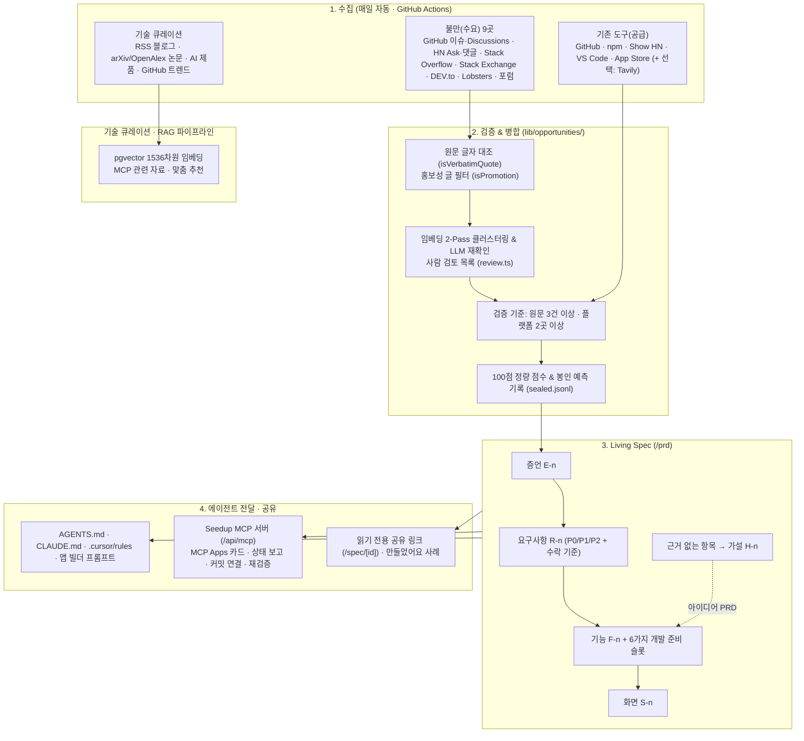

<div align="center">

# 🌱 Seedup

**개발자들이 공개 글에 남긴 실제 불만을 원문과 글자 단위로 대조해 모으고,**  
**그 원문을 근거로 한 PRD(Living Spec)와 코딩 에이전트 지침(`AGENTS.md` · MCP)까지 한 흐름으로 이어 주는 서비스**

[](https://seedup.rerereally.com)
[](https://nextjs.org/)
[](https://react.dev/)
[](https://supabase.com/)
[](https://modelcontextprotocol.io/)

[왜 Seedup인가](#-왜-seedup을-만들었는가-why-seedup) · [아키텍처](#️-아키텍처--근거-추적-파이프라인) · [주요 기능](#-주요-기능) · [현재 상태와 한계](#-현재-상태와-한계-2026-11-21-기준) · [빠른 시작](#-빠른-시작) · [MCP 연결](#-mcp-서버-연결-claude--codex--cursor--antigravity-등) · [배포](#️-배포-cloudflare-workers)

</div>

---

## 👥 참여 인원 (Team)

| 이름 | 역할 및 담당 |
| :---: | :--- |
| **정지훈** | 프로젝트 총괄 설계 · 기회 엔진 & Living Spec(`E→R→F→S`) · RAG/추천 파이프라인 · MCP 서버 · 풀스택 개발 |
| **장차희** | 서비스 기획 · 데이터 검증 및 큐레이션 설계 · UI/UX 개편(소개 페이지, 앱 셸, PRD 작업 화면) · 품질 테스트 |

---

## 💡 왜 Seedup을 만들었는가? (Why Seedup?)

> *"코딩 에이전트(Cursor, Claude Code) 덕분에 **'어떻게 만들까'**는 10배 빨라졌습니다. 그런데 **'무엇을, 왜 만들어야 하는가'**에는 여전히 근거가 없습니다. LLM에게 물으면 무조건 좋은 아이디어라고 맞장구치거나(Sycophancy), 있지도 않은 근거를 지어냅니다(Hallucination). 그래서 **실제 개발자가 공개 글에 남긴 불만에서 출발해, 그 원문을 PRD와 에이전트 지침까지 끊기지 않게 전달하는 도구**를 만들었습니다."*

### 기존 서비스와 다른 점

| 비교 영역 | 뉴스레터 · 트렌드 서비스 | AI PRD · 아이디어 생성 도구 | **🌱 Seedup** |
| :--- | :--- | :--- | :--- |
| **근거** | 요약은 주지만 원문 근거는 약함 | 짧은 프롬프트만 보고 그럴듯한 PRD 생성 | LLM이 뽑은 인용이 **원문에 글자 그대로 있을 때만** 채택(`isVerbatimQuote`). 증언 근거가 없는 요구사항은 서버가 **가설(H-n)**로 따로 둠 |
| **시장 확인** | 경쟁 상황 분석 없음 | 이미 같은 도구가 있어도 칭찬함 | GitHub · npm · Show HN · VS Code · App Store에서 기존 도구를 찾아 **직접 경쟁 수**와 시장 상태(`open` / `narrowing` / `closed`)를 표시 |
| **코딩 연결** | 읽기에서 끝남 | 마크다운 한 장으로 끝남 | `증언(E) → 요구사항(R) → 기능(F) → 화면(S)` 추적, 6가지 개발 준비 슬롯, `AGENTS.md` / `CLAUDE.md` / `.cursor/rules` 내보내기, **MCP 서버(작업 진행·커밋 역추적·재검증 포함)**로 에이전트가 직접 가져감 |
| **기존 프로젝트** | 지원 안 함 | 새 아이템만 다룸 | 내 GitHub 저장소를 분석해 **다음 기능 3가지와 역기획 스펙**을 제안(`/prd/repo`) |

---

## 🏗️ 아키텍처 & 근거 추적 파이프라인



### 모델을 믿지 않는 네 겹의 확인

무료 LLM이 틀리거나 지어내는 것을 전제로, 각 단계 결과를 코드가 다시 확인합니다.

| 단계 | 하는 일 | 위치 |
|---|---|---|
| 1. 원문 글자 대조 | 모델이 뽑은 인용이 원문에 글자 그대로 있을 때만 근거로 채택 | `isVerbatimQuote` (`lib/opportunities/rules.ts`) |
| 2. 구조 검사 | 요구사항, 기능, 화면의 참조를 강제하고 원문이 없는 요구사항은 가설(`H-n`)로 분리 | `normalizeSpec` (`lib/opportunities/spec.ts`) |
| 3. P0 점검 | P0마다 테스트 가능한 수락 기준이 있는지 검사하고 없으면 한 번 수정. 이어서 작성 모델과 다른 모델(P0 Critic)이 P0마다 인용 원문이 정말 뒷받침하는지 보고, 과장은 줄이고 뒷받침하지 않으면 가설(H-n)로 내림 | `specIssues`, `prd-audit.ts` |
| 4. 정량 평가 | 같은 20건을 고정해 PRD 품질을 반복 측정 | `scripts/eval-prd.ts`, `scripts/judge-prd.ts` |

비슷한 불만을 한 문제로 묶을 때는 임베딩 군집을 두 번 돌립니다. 한 번 묶은 뒤 모든 글을 최종 중심과 다시 비교해, 입력 순서 때문에 동떨어진 글이 줄줄이 붙는 것을 막습니다(`clusterByEmbedding`).

측정 결과는 [docs/scorecard.md](docs/scorecard.md)에 있습니다. 같은 20건 기준으로 생성 성공 19/20에서 20/20, PRD당 형식 지적 0.7에서 0, 내용 종합 3.0에서 7.4(10점 만점), 걸린 시간 중간값 64초에서 55초입니다. 운영에 공개된 인용 63개 중 83%(52/63)가 원문과 맞았습니다(팀 확인 중).

---

## 🚀 주요 기능

### 1. 홈 (`/`)
- **아이디어 한 줄 입력:** 입력하면 그 아이디어와 가까운 실제 원문을 바로 보여 주고, PRD 작업 화면으로 이어집니다.
- **소개 섹션:** 원문이 흐르는 띠, 원문 → PRD → 에이전트 단계 설명, 불만이 먼저 나오고 도구가 나중에 나온 기록 차트.
- **로그인 후 작업대:** 오늘 읽을 글 배너 슬라이더, 시작 체크리스트(관심 분야 → 첫 PRD → 에이전트 연결), 최근 킵한 것, 나를 위한 추천, 만들 만한 문제, 킵한 저장소의 새 릴리스.

### 2. 인사이트: 검증된 문제 목록 (`/newsletter-preview`, `/opportunities/[slug]`, `/predictions/sealed.jsonl`)
- 주간 호와 함께 기준을 통과한 문제와 아직 모으는 중인 문제를 보여 줍니다. (`/opportunities`는 이 목록으로 이동합니다.)
- **문제 상세:**
  - 원문(영어 원문 · 한국어 번역 · 원문 링크)
  - **점수 내역 100점:** 원문 수 30 · 플랫폼 폭 20 · 반응 15 · 최근성 15 · 남은 빈틈 20. AI가 매긴 점수가 아니라 저장된 수치로만 계산합니다.
  - 왜 지금인가, 성장 기록, 이미 있는 도구, 혼자 만들 때의 규모 추정, **첫 10명 찾기**(원문 작성자가 있는 곳, 만나면 물어볼 것, 링크 없는 답글 초안)
- **사람 검토 목록(`lib/opportunities/review.ts`):** 원문이 글자 그대로 맞아도 다른 이야기를 하는 인용은 빼고, 엔진 규칙상 걸러졌어야 할 문제(한 제품의 기능 요청 등)는 숨깁니다. 사이트 · MCP · 메일에 한 번에 적용됩니다.
- **봉인 예측 적중 기록(`/predictions`):** 봉인 시점과 최근 수집 기록을 비교하고 기한 내 직접 경쟁 도구 출시 여부를 확인합니다. 해시가 있는 원본은 `/predictions/sealed.jsonl`에서 내려받을 수 있습니다.

### 3. 근거 추적 PRD 작업 화면 (`/prd`, `/prd/new`, `/spec/[id]`)
- **아이디어에 맞춘 질문:** 아이디어와 가까운 원문을 보고, PRD를 바꾸는 결정(첫 사용자, 쓰는 순간, 첫 버전의 한 가지, 플랫폼, 성공 기준, 제약)만 객관식 3~5개로 묻습니다(`lib/opportunities/questions.ts`). 모델이 답하지 않으면 고정 질문으로 바뀝니다.
- **쓰는 대로 보이는 PRD:** 모델이 마크다운 문서(배경, 대상, 사용 장면, 목표, 요구사항과 수락 기준, 기능, 위험, 가정, 지표, 열린 질문)를 쓰는 대로 화면에 흘려 보내고(`streamText`, NDJSON + 15초 keep-alive ping), 끝나면 그 문서를 구조로 읽어 근거 검사와 자동 보완을 거칩니다(`prd-markdown.ts`, `normalizeSpec()`).
- **근거가 없을 때:** 기준 미달이면 웹 원문 찾기를 먼저 자동으로 돌리고, 그래도 없으면 가설마다 누구에게 무엇을 물어 확인할지 씁니다. 지켜보기, 소개 페이지, 직접 들은 말(인터뷰·메모, 기준에는 안 셈)로 이어집니다.
- **`E-n → R-n → F-n → S-n` 추적:** 모든 요구사항은 증언을, 기능은 요구사항을, 화면은 기능을 참조해야 하며 서버(`normalizeSpec()`)가 강제합니다. 증언 근거가 없는 요구사항은 **가설(H-n)**로, 기준 미달 문제로 만든 PRD는 **가설 초안**으로 표시합니다.
- **5가지 보기:** 문서 · 기능 명세(근거 추적) · 유저플로우 · 와이어프레임 · 구조 트리. 항목을 누르면 연결된 원문과 상하위 항목이 함께 강조됩니다(`traceOf`).
- **6가지 개발 준비 슬롯**(기능마다): 입력·상태 조건, 비즈니스 규칙, 예외·오류 처리, 권한, 데이터, 완료 기준. 정해지지 않은 항목은 에이전트가 먼저 묻도록 적습니다.
- **대화형 수정과 버전 기록:** 원문 목록은 고정한 채 자연어로 고치거나 항목 하나만 고치고, 고칠 때마다 버전과 바뀐 줄을 남깁니다. 버전은 이 브라우저에 남아 새로고침해도 이어집니다.
- **근거 직접 추가:** 글 링크를 붙이면 Seedup이 그 글을 읽어 글자 단위로 맞는 문장만 원문으로 담습니다. 크롬 확장으로 담은 문장도 여기 나옵니다.
- **내보내기와 공유:** `AGENTS.md` · `CLAUDE.md` · `.cursor/rules`, Lovable · Bolt · v0용 첫 프롬프트, PRD 마크다운, Mermaid 코드 복사. 보관함에서 읽기 전용 공개 링크(`/spec/[id]`)를 켜고, 만든 결과물 링크("만들었어요")를 붙일 수 있습니다.

### 4. 아이디어 검증 (`/prd/validate`, `/try/[slug]`)
- `/prd` 입력창의 토글에서 **아이디어 검증**을 고르면 왼쪽 대화, 오른쪽 평가 결과 화면으로 열립니다(예전 `/ideas`는 이리로 넘어옵니다).
- **검증 리포트(하루 3건):** 원문과 경쟁 도구로 실패할 이유를 먼저 보여 주고, 수요·공급·타이밍·도달·실행 적합을 규칙으로 판단합니다. 첫 사용자 후보와 인터뷰 질문, 대기 신청 페이지로 이어집니다.
- **명확성 점검:** 리포트를 만들기 전에 아이디어에 누가 겪는지, 어떤 문제인지, 어떻게 푸는지가 빠졌는지 보고, 빠진 것을 채운 예시 문장을 제안합니다. 리포트 한도는 쓰지 않으며 리포트를 막지도 않습니다. 예전 0~100점 AI 평가는 근거 없는 숫자라 없앴습니다.
- **지켜보기:** 아이디어를 등록하면 매주 새 원문과 새 경쟁 도구를 메일로 알려 줍니다(최대 10개).
- **검증 실험 키트(`/try/[slug]`):** 아이디어 소개 공개 페이지와 대기자 명단, CSV 내려받기. 프로필에서 관리합니다.

### 5. MCP 연동 (`/agents`)
- **도구 9가지 연결:** Claude Code, Claude 앱, Codex, Cursor, VS Code, Antigravity, Gemini CLI, Windsurf, ChatGPT마다 맞는 설정을 보여 주고, 복사하거나 열 때 토큰 발급까지 한 번에 합니다. 토큰(`sdp_...`)은 DB에 SHA-256 해시로만 저장합니다.
- **MCP Apps 카드 UI (`lib/mcp/apps.ts`):** Claude 데스크톱·웹, VS Code Copilot 등 MCP Apps 지원 클라이언트에서는 검색 결과·PRD·체크리스트·다음 작업을 인터랙티브 카드로 함께 렌더링합니다.
- **표준 Streamable HTTP JSON-RPC 2.0 서버(`lib/mcp/server.ts`)**, 도구 20개(`[개발]` 12개 · `[기획]` 8개)와 프롬프트 4개(`discover-and-spec`, `build-next-feature`, `pre-ship-audit`, `why-this-file`), 리소스(`seedup://prds/active`, `seedup://kept/recent`). 도구마다 `readOnlyHint` 등 annotations를 달아, 하루 한도를 쓰는 도구는 실행 전에 확인을 받습니다.
- **진행 중 PRD 고정:** 에이전트가 만들거나 사이트에서 저장한 PRD를 사용자별로 고정해, 매일 엔진이 원문을 더해도 기능 번호(`F-n`)와 진행 기록이 어긋나지 않습니다.

| 도구 | 하는 일 |
| :--- | :--- |
| `resume_project` | `[개발]` 잠긴 목표, 연결 저장소, 전체 기능(`F-n`) 체크리스트(상태·완료 기준·미연결 커밋 수), 최근 결정과 마지막 인수인계로 작업 재개 |
| `setup_project` | `[개발]` 저장소에 쓸 파일(`AGENTS.md`, `AGENTS.md`를 가리키는 한 줄 `CLAUDE.md`, 목표 잠금 시 pre-commit 포함 로컬 훅 묶음)을 `{ path, content }`로 반환(토큰 없음) |
| `get_next_task` | `[개발]` 잠긴 목표와 최근 프로젝트 기억을 보여 주고 목표 기여도 순으로 다음 기능을 선택. 준비 슬롯·검증 원문·관련 파일·상태 보고 명령 포함 |
| `update_feature_status` | `[개발]` 기능 상태 보고. `done`에 해당 SHA의 검증 토큰이 있으면 🟢 감독관 검증. 일반 모드에서는 기준별 통과 증빙으로 ⚪ 자가 보고 가능. `blocked` 진입 시 웹훅 알림 |
| `verify_feature` | `[개발]` 연결한 공개 GitHub 저장소에서 전체 40자리 커밋 SHA와 CI를 읽어 서버의 기능 완료 기준으로 검증하고 커밋을 자동 연결. 같은 `(feature, sha)` 재호출로 진행 중·저장 결과를 조회 |
| `link_commit` | `[개발]` 커밋 SHA·메시지·변경 파일 경로(선택: 파일 상태)를 기능 `F-n`에 연결하고, 이미 완료된 다른 기능의 파일을 건드리면 자동으로 `needs_recheck` 표시 |
| `explain_file` | `[개발]` 파일 경로가 어떤 기능(`F-n`), 요구사항(`R-n`), 원문(`E-n`) 때문에 있는지 역추적 |
| `connect_repo` | `[개발]` 공개 GitHub 저장소(`owner/repo`)를 프로젝트에 연결 |
| `check_env` | `[개발]` 에이전트가 보고한 로컬 환경 키 이름을 프로젝트에 필요한 이름과 비교 |
| `record_decision` | `[개발]` 결정과 이유, 관련 기능·성공 기준, 터미널 대화에서 받은 승인 결과 기록 |
| `save_handoff` | `[개발]` 하던 일, 다음 할 일, 주의 사항과 검증 전 커밋을 인수인계로 저장 |
| `get_project_memory` | `[개발]` 프로젝트의 결정·인수인계·사실을 종류별 최신순으로 조회 |
| `search_opportunities` | `[기획]` 검증된 문제를 키워드로 검색 |
| `get_opportunity` | `[기획]` 문제 · 빈틈 · 원문(`E-n`) · 경쟁 도구 상세 |
| `generate_verified_prd` | `[기획]` 근거 추적 PRD를 `AGENTS.md` / `CLAUDE.md` / `.cursor/rules` / 프롬프트 / 마크다운으로 생성(하루 10회, 같은 근거면 캐시) |
| `get_my_prd` | `[기획]` `id`를 비우면 내가 저장한 PRD 목록, `id`를 넣으면 해당 PRD를 마크다운이나 에이전트 파일 형식으로 조회 |
| `validate_idea` | `[기획]` 아이디어 검증 리포트(하루 3회) |
| `watch_idea` | `[기획]` 아이디어 지켜보기 등록(최대 10개) |
| `get_kept_items` | `[기획]` 보관함에 킵한 저장소 · 아티클 · 논문 · 제품 |
| `find_related_content` | `[기획]` 아이디어와 의미가 가까운 뉴스 · 논문 · 저장소 · 제품 |

프로젝트 도구의 `project` 또는 `slug`에 공개 기회 slug나 `get_my_prd`가 반환한 개인 PRD 키 `prd:<id>`를 넣습니다.

### 6. 레포 분석 (`/prd/repo`)
- `/prd` 입력창의 토글에서 **레포 분석**을 고르면 왼쪽 대화의 레포 목록에서 하나를 골라 오른쪽에서 봅니다(예전 `/seeds`는 이리로 넘어옵니다).
- GitHub 계정의 최근 공개 저장소(포크 제외)를 README · 언어 · 토픽으로 분석해 가까운 문제, 관련 아티클, 비슷한 오픈소스를 연결합니다.
- **다음 기능 3가지 제안:** 저장소의 `issues/new`를 제목과 본문이 채워진 상태로 바로 엽니다.
- **역기획(Reverse Spec):** README, 상위 2단계 파일 트리, `package.json` / `pyproject.toml`을 읽어 **깨면 안 되는 기존 구조**를 지키며 새 기능 스펙을 만듭니다.
- arXiv + OpenAlex 논문 최대 3편 추천.

### 7. 아티클 · 트렌드 (`/news`, `/papers/[id]`, `/trends`, `/github-trends`, `/ai-products`)
- 트랙별 데일리 아티클(원문 3개 이상, 소스 종류 2개 이상 모인 묶음만 발행)과 문장별 출처 구분(원문 근거 / 추론 / 배경지식).
- 글 · 논문 상세 오른쪽의 **글 도우미 챗봇**(`POST /api/articles/ask`): 벡터 검색 없이 그 글의 본문을 근거로 답합니다.
- GitHub 급상승 저장소, AI 제품 레이더(별점 · 리뷰), 모델 리더보드.

### 8. 알림 · 개인화
- **맞춤 추천(`lib/recommendations.ts`, `lib/personal.ts`):** 온보딩 관심사 + 킵 · 좋아요 · 싫어요 · 관심 없음 + 신선도. 임베딩이 없어도 규칙 기반으로 동작합니다.
- **메일:** 주간 뉴스레터, 기회 변동 다이제스트, **매일 리서치 메일**(Resend, 수신자별 실패 격리, `newsletter_sends` + `Idempotency-Key`로 중복 발송 방지). 지난 호는 웹(`/newsletter-preview/[period]`)에 쌓입니다.
- **디스코드 · 슬랙 웹훅:** 주간 신호와 변경 알림, MCP `blocked` 상태 알림을 채팅 채널로 보냅니다.

### 9. 크롬 확장 (`extension/`)
- GitHub · Hacker News · Stack Overflow에서 문장을 고르고 오른쪽 클릭 → **Seedup에 원문으로 담기**. Seedup이 원문을 다시 읽어 글자 그대로 있는지 확인한 뒤 PRD 근거로 보관합니다(하루 60개). 설치 방법은 [extension/README.md](extension/README.md).

### 10. 관리자 (`/admin/ingest`)
- 수집 단계별 실행과 성공/실패, 임베딩 백필, 다이제스트 미리보기와 발송, 소스별 승인율과 품질 미달 기록(`ingest_rejections`), 서버 오류 기록(`app_errors`).
- 사용 지표(PRD 성공률과 걸린 시간 포함), 허용 모델 정책, DB 마이그레이션 적용 여부 점검.

---

## 📊 현재 상태와 한계 (2026-11-21 기준)

숨기지 않고 적습니다.

| 항목 | 지금 상태 |
| :--- | :--- |
| 공개 중인 문제 | **스냅샷 기준 37개, 그중 검증 기준(원문 3건 · 플랫폼 2곳) 통과 13개.** 기준은 일부러 엄격하게 두고, 매일 수집·보충으로 통과 수를 키웁니다 |
| 원문 검증의 한계 | 글자 대조(`isVerbatimQuote`)는 "그 문장이 원문에 있다"만 보장하고 "그 문제와 관련 있다"는 보장하지 않습니다. 그래서 LLM 재확인과 사람 검토 목록(`review.ts`)을 함께 둡니다 |
| 모델 | 웹 PRD · 검증 리포트 · 질문은 유료 체인(GPT 6.2 Sol → Claude Haiku 5.5)이 기본이고, 유료가 모두 실패할 때만 무료 모델로 폴백합니다. 수집 엔진은 무료 OpenRouter 모델로 매일 돌아 일부 호출이 실패할 수 있고, 실패하면 이전 결과를 유지하고 사용자 일일 한도는 돌려줍니다 |
| 수요로 섞이는 글 | `isPromotion()`으로 제품 출시·홍보성 글(`Show HN`, `I just built...`)을 1차 필터링하지만, 본문 후반부 홍보성 문장 등 일부 오탐은 사람 검토 목록으로 보정합니다 |
| 선행 기록 | "불만이 먼저 나오고 도구가 나중에 나왔다"는 기록과 봉인 예측(`sealed.jsonl`)은 참고용입니다. 인과관계를 뜻하지 않습니다 |
| 영어 | 홈 · 문제 · PRD 등 주요 화면만 영어를 지원합니다 |
| 사용자 검증 | 실사용자 테스트를 진행·준비 중입니다([docs/user-interview.md](docs/user-interview.md)) |
| 테스트 | 단위 테스트 파일 76개. #220 기준 520개 중 518개 통과, 1개 건너뜀. 실패 1개(`prd-exports`의 gh 명령 테스트)는 `/bin/sh`가 없는 Windows에서만 나고 Linux CI에서는 통과합니다. 브라우저 E2E 3개(세 입구 → 목표 잠금 → 에이전트 핸드오프) 통과 |
| DB 마이그레이션 | 39개. 운영 DB에는 `20261121020000_dossier_validation_report.sql`, `20261121080000_agent_usage.sql` 두 개가 아직 적용되지 않았습니다 |
| MCP | 도구 20개, 프롬프트 4개, 리소스 2개 |
| 실제 프로젝트 | 2026-11-21 시험 프로젝트 1개(트랙 A CLI)가 PRD → 목표 잠금 → 에이전트 구현 → GitHub CI → 서버 판정 → 🟢까지 운영에서 한 번 갔습니다. 발견한 문제와 남은 검증은 [docs/status.md](docs/status.md) "실제 프로젝트 검증" |

지금 상태는 [docs/status.md](docs/status.md), 방향은 [docs/supervisor-plan.md](docs/supervisor-plan.md), 문서 목록은 [docs/README.md](docs/README.md)에 있습니다.

---

## 🛠️ 기술 스택

| 영역 | 사용 기술 |
| :--- | :--- |
| **Frontend** | Next.js 16 (App Router), React 19, TypeScript, Tailwind CSS 4, Lucide React |
| **Backend & DB** | Supabase PostgreSQL, Row Level Security, `pgvector` (1536차원), 데이터 접근 계층(`lib/db/*`) |
| **인증** | Supabase Auth (Google · GitHub OAuth), SHA-256 해시 개인 MCP 토큰 |
| **AI** | OpenRouter(무료·유료 모델), LG AI연구원 EXAONE API(`k-exaone_v2.5`). 임베딩 기본값 `nvidia/nemotron-3-embed-1b:free`(2048차원을 앞 1536차원으로 잘라 정규화) |
| **수집** | `rss-parser`, GitHub REST · GraphQL, Hacker News Algolia, Stack Exchange, DEV.to, Lobsters, Discourse 포럼, npm, VS Code Marketplace, App Store, arXiv, OpenAlex, 선택: Tavily 웹 검색 |
| **에이전트 연동** | MCP (Streamable HTTP JSON-RPC 2.0 + MCP Apps UI), `AGENTS.md` / `CLAUDE.md` / `.cursor/rules` |
| **메일 · 예약 작업** | Resend, GitHub Actions 예약 워크플로 |
| **배포 · 보호** | Cloudflare Workers (`@opennextjs/cloudflare`), Cloudflare Rate Limiting 바인딩(`RL_6`/`RL_12`/`RL_30`/`RL_60`) |

---

## ⚡ 빠른 시작

### 1. 사전 요구사항
- **Node.js** 20.9 이상 / **npm** 10 이상
- **Supabase** 프로젝트(`pgvector` 확장 활성화)
- **OpenRouter** API 키
- *(선택)* LG EXAONE API 키, GitHub 토큰, Google/GitHub OAuth 클라이언트, Resend API 키, Tavily API 키

### 2. 설치

```bash
git clone https://github.com/rerereally/Seedup_ver2.git
cd Seedup_ver2
npm install
cp .env.example .env
```

### 3. 환경변수 (`.env`)

필수 값입니다. 전체 목록과 설명은 [.env.example](.env.example)에 있습니다. 실제 키는 `.env`에만 넣고 `.env.example`에는 넣지 않습니다.

```env
# Supabase
NEXT_PUBLIC_SUPABASE_URL=https://your-project.supabase.co
NEXT_PUBLIC_SUPABASE_PUBLISHABLE_KEY=sb_publishable_your-key
SUPABASE_SECRET_KEY=sb_secret_your-key

# OpenRouter (LLM & 임베딩)
OPENROUTER_API_KEY=your-openrouter-api-key
OPENROUTER_MODEL=nvidia/nemotron-3.5-super-vl:free
OPENROUTER_FALLBACK_MODELS=recursive/flint-v1.0:free,openrouter/free
# true면 유료 모델(웹 PRD · 검증의 기본 유료 체인 포함)이 전부 막힙니다. 로컬 실험용이고 운영에서는 지웁니다
OPENROUTER_FREE_ONLY=true
RAG_EMBEDDING_MODEL=nvidia/nemotron-3-embed-1b:free

# 사이트 & 관리자
NEXT_PUBLIC_SITE_URL=http://localhost:3000
INGEST_SECRET=change-this-secret
ADMIN_EMAILS=you@example.com
```

<details>
<summary><b>선택 환경변수 (EXAONE, PRD 모델, 서명 키, GitHub, 메일, 웹 검색, 수집 옵션)</b></summary>

```env
# LG EXAONE (선택: K-EXAONE 2.5 모델 사용 시)
EXAONE_API_KEY=
EXAONE_REASONING_EFFORT=low

# PRD 무료 모델 우선순위 및 라이브 원문 서명 키
PRD_FREE_MODELS=baidu/ernie-5.5-flash-preview:free,particle-ai/particle-1:free,nvidia/nemotron-3-ultra-550b-a55b:free
LIVE_EVIDENCE_SECRET=
# MCP 토큰 서명 키: 없으면 SUPABASE_SECRET_KEY를 씁니다. 한번 정하면 바꾸지 마세요(바꾸면 기존 MCP 연결이 끊김).
MCP_TOKEN_SECRET=

# 외부 수집 API
GITHUB_TOKEN=your-github-token
GITHUB_MIN_STARS=50
HUGGINGFACE_TOKEN=your-huggingface-token
STACKEXCHANGE_KEY=your-stackexchange-key

# 메일 (Resend)
RESEND_API_KEY=your-resend-api-key
NEWSLETTER_FROM_EMAIL="Seedup <newsletter@your-domain.com>"

# 엔진의 웹 원문 · 경쟁 도구 검색(없으면 건너뜀)
TAVILY_API_KEY=
# 엔진의 원문 보충 검색 모델 및 동시성(무료 모델이 자주 빈 답을 줄 때)
# ENGINE_EVIDENCE_MODEL=exaone
# ENGINE_TOPUP_CONCURRENCY=3

OPENROUTER_TIMEOUT_MS=45000
OPENROUTER_ARTICLE_TIMEOUT_MS=75000
MAX_ITEMS_PER_SOURCE=10
RSS_RECENT_WINDOW_DAYS=7
INGEST_OPENROUTER_MODEL_LIMIT=20
CRON_SECRET=optional-cron-secret
INGEST_INTERNAL_URL=http://localhost:3000
```
</details>

### 4. 데이터베이스(Supabase)

DB 변경은 [supabase/migrations](supabase/migrations)에 `<YYYYMMDDHHMMSS>_<이름>.sql`로 총 **30개**가 순서대로 쌓여 있습니다. 첫 파일(`20261101000000_initial.sql`)이 전체 테이블 · 인덱스 · RLS이고, 나머지는 운영에 적용했던 순서의 증분 변경입니다. 테스트용 더미 데이터는 [supabase/seed.sql](supabase/seed.sql)(로컬 `supabase db reset` 전용), 정리 SQL은 [supabase/delete_dummy.sql](supabase/delete_dummy.sql)입니다.

1. **새 프로젝트:** `npx supabase link --project-ref <ref>` 후 `npx supabase db push`. 로컬 DB(Docker 필요)는 `npx supabase start` 또는 `npx supabase db reset`.
2. **새 변경 추가:** `supabase/migrations/`에 다음 시각 접두사로 파일을 만들고 `npx tsx scripts/check-migrations.ts --write`로 `lib/schema-manifest.json`을 갱신합니다. CI(`npm run migrations`)가 파일 이름 · 순서와 매니페스트 일치 여부를 검증합니다.
3. **스키마 및 RLS 점검:** 빠진 변경 확인은 `npx tsx --env-file=.env scripts/check-schema.ts`, RLS 격리 확인은 `npm run rls`로 실행합니다.
4. **OAuth Redirect URL 등록** (`Authentication > URL Configuration`):
   - `http://localhost:3000/auth/callback`
   - `https://seedup.rerereally.com/auth/callback`

<details>
<summary><b>마이그레이션 전체 목록 (30개) 및 운영 DB CLI 기록 동기화(최초 1회)</b></summary>

운영 DB에 SQL 편집기로 먼저 적용해 둔 뒤 CLI 기록(`supabase_migrations.schema_migrations`)을 맞출 때 한 번만 실행합니다.

```bash
npx supabase link --project-ref <운영 project ref>
npx supabase migration repair --status applied \
  20261101000000 20261109211638 20261110155444 20261111090932 \
  20261114222837 20261114223012 20261114225830 20261114230113 \
  20261114230205 20261116172120 20261116181543 20261117111335 \
  20261118120720 20261118120947 20261118121344 20261118121507 \
  20261118121746 20261118121957 20261118190338 20261119112104 \
  20261119112105 20261119120000 20261119150000 20261119160000 \
  20261119160100 20261119170000 20261120010000 20261120090000 \n  20261120123000
npx supabase migration list
```

| 파일 | 하는 일 |
| :--- | :--- |
| `20261101000000_initial.sql` | 전체 테이블 · 인덱스 · RLS 기본 스키마 |
| `20261109211638_hardening.sql` | 수집 로그 서버 전용 제한, 아이디어 평가 RLS 강화 |
| `20261110155444_opportunities.sql` | 기회 엔진(`opportunities`), 증언 도시에(`evidence_dossiers`), 일일 AI 쿼터(`ai_usage`, `consume_ai_usage`) |
| `20261111090932_newsletter_sends.sql` | 메일 중복 발송 방지(`newsletter_sends`) |
| `20261114222837_view_count.sql` | 조회수 원자적 증가(`increment_content_view`) |
| `20261114223012_usage_refund.sql` | 생성 실패 시 쿼터 반환(`release_ai_usage`) |
| `20261114225830_prd_cache.sql` | 같은 근거 PRD 캐시(`prd_cache`) |
| `20261114230113_mcp_tokens.sql` | 개인 MCP 토큰(`mcp_tokens`) |
| `20261114230205_dossier_share.sql` | PRD 공개 공유 링크(`/spec/[id]`) |
| `20261116172120_newsletter_issues.sql` | 주간 뉴스레터 웹 보관(`newsletter_issues`) |
| `20261116181543_build_progress.sql` | MCP 구현 완료 체크리스트(`build_progress`) |
| `20261117111335_prd_models.sql` | PRD 허용 모델(`app_settings`), 실행 기록(`prd_runs`) |
| `20261118120720_repo_releases.sql` | 킵한 저장소 최신 릴리스(`github_trends.latest_release`) |
| `20261118120947_built.sql` | 공유 PRD "만들었어요" 링크 · 메모 |
| `20261118121344_idea_watches.sql` | 아이디어 지켜보기(`idea_watches`) |
| `20261118121507_notify_webhook.sql` | 디스코드 · 슬랙 웹훅(`user_onboarding.notify_webhook`) |
| `20261118121746_saved_quotes.sql` | 크롬 확장으로 담은 원문(`saved_quotes`) |
| `20261118121957_idea_pages.sql` | 검증 실험 키트 페이지 · 대기자 명단(`idea_pages`, `waitlist_signups`) |
| `20261118190338_mcp_usage.sql` | MCP 호출 쿼터 원자적 차감(`consume_ai_usage_for`) |
| `20261119112104_app_errors.sql` | 서버 오류 기록(`app_errors`) |
| `20261119112105_feature_status.sql` | MCP 기능 상태 확장(`in_progress`/`improving`/`blocked`) 및 이력 |
| `20261119120000_feature_commits.sql` | 기능별 커밋 연결(`feature_commits`) |
| `20261119150000_built_example_counts.sql` | 문제별 "만들었어요" 공개 수 집계 RPC(`built_example_counts`) |
| `20261119160000_feature_recheck.sql` | 공유 파일 수정 시 완료 기능 자동 `needs_recheck` 표시 RPC |
| `20261119160100_commit_dismiss.sql` | 미연결 커밋 숨기기(`dismissed_commits`) |
| `20261119170000_daily_research_mail.sql` | 매일 리서치 메일 구독 설정 |
| `20261120010000_opportunity_reviews.sql` | 사람 검토 목록: 문제 숨기기 · 인용 빼기(`opportunity_reviews`) |
| `20261120090000_public_prds.sql` | 공개 PRD 목록(`/spec`)에 올리기(`evidence_dossiers.listed`) |
| `20261120123000_prd_reports.sql` | 공개 PRD 신고와 관리(`prd_reports`, `submit_prd_report`) |
| `20261120130000_section_views.sql` | PRD 섹션 조회 기록(`section_views`). **운영 DB 미적용** |

</details>

### 5. 로컬 실행과 검증

```bash
npm run dev          # http://localhost:3000
npm run migrations   # 마이그레이션 파일 이름·순서·매니페스트 검증
npm run typecheck
npm run lint
npm test             # 단위 테스트 318개(48개 파일)
npm run build
npm run e2e          # Playwright 브라우저 E2E 테스트
SMOKE_BASE_URL=http://localhost:3000 npm run smoke   # 주요 화면 · API 스모크 테스트
```

DB 설정이 없으면 기회 데이터는 코드에 포함된 예비 데이터(`lib/opportunities/data/snapshot.json`)로 보입니다.

---

## 🔌 MCP 서버 연결 (Claude · Codex · Cursor · Antigravity 등)

1. 로그인 후 **MCP 연동(`/agents`)**에서 쓰는 도구를 고릅니다. Claude Code, Claude 앱(데스크톱·웹), Codex, Cursor, VS Code, Antigravity, Gemini CLI, Windsurf, ChatGPT를 지원합니다. 복사하거나 열면 토큰 발급까지 한 번에 됩니다.
2. 헤더를 넣을 수 있는 도구는 `Authorization: Bearer <토큰>`으로 연결합니다. Claude 앱과 ChatGPT 커넥터처럼 주소만 받는 곳은 `https://seedup.rerereally.com/api/mcp/<토큰>`을 씁니다. 이 주소는 비밀번호처럼 다룹니다. Claude Code 예시:
   ```bash
   claude mcp add --transport http seedup https://seedup.rerereally.com/api/mcp \
     --header "Authorization: Bearer <발급받은_토큰>"
   ```
3. 에이전트에게 바로 지시합니다.
   > *"Seedup에서 AI 코딩 컨텍스트 공유 문제를 찾아 검증된 `AGENTS.md` 스펙을 만들고 `get_next_task`로 `F-01`부터 구현해 줘."*

---

## 🔄 데이터 수집 · 기회 엔진 · 메일 실행

### 1. 기회 엔진 (`lib/opportunities/`)
```bash
# 실행 결과를 이전 결과에 합쳐 예비 데이터(lib/opportunities/data/snapshot.json)만 갱신
npm run engine

# 위 + Supabase opportunities 테이블에 게시
npm run engine -- --persist

# 예측 시그널 타임스탬프 봉인
npm run seal
```
매일 07시(KST) GitHub Actions(`opportunity-engine.yml`)가 `--persist`로 실행합니다. 한 번의 실행은 이전 결과에 합쳐지므로 원문은 쌓이고, 약한 실행이 있어도 잃지 않습니다.

밖에서 모은 원문 파일(JSONL)을 공용 근거(`found_evidence`)에 넣을 때는 아래 명령을 씁니다. 줄마다 원문 링크를 다시 받아 글자 대조를 통과한 문장만 넣습니다.
```bash
npm run import-evidence -- --dir <JSONL 폴더> --dry-run   # 넣지 않고 통과 · 버림 수만 집계
npm run import-evidence -- --dir <JSONL 폴더>             # 실제로 적재
```

### 2. 콘텐츠 수집과 임베딩 (`/api/ingest/*`)
관리자 계정으로 `/admin/ingest`에서 실행하거나 `x-ingest-secret` 헤더로 호출합니다(URL 쿼리의 비밀값은 받지 않습니다). 매일 06시(KST) `scheduled-ingest.yml`이 실행합니다.

```bash
BASE_URL=http://localhost:3000
SECRET=YOUR_INGEST_SECRET

# 전체: 수집 → 집계 → 아티클/아이디어 생성 → 임베딩
curl -X POST -H "x-ingest-secret: $SECRET" "$BASE_URL/api/ingest/all"

# 빠진 임베딩만 채우기
curl -X POST -H "x-ingest-secret: $SECRET" "$BASE_URL/api/ingest/embeddings?perSource=1000&max=200"

# 임베딩 모델을 바꾼 뒤 전부 다시 만들기
npx tsx --env-file=.env scripts/reembed.ts
```

### 3. 메일과 점검 스크립트
```bash
npx tsx --env-file=.env scripts/send-opportunity-digest.ts --kind changes   # 변동 다이제스트 (--dry-run: 보내지 않고 미리보기)
npx tsx --env-file=.env scripts/send-opportunity-digest.ts --kind weekly    # 주간 호
npx tsx --env-file=.env scripts/check-idea-watches.ts                       # 아이디어 지켜보기 메일
npx tsx --env-file=.env scripts/check-prd-health.ts                         # PRD 성공률 점검
npx tsx --env-file=.env scripts/eval-prd.ts                                 # PRD 품질 평가 세트
```

---

## 📂 폴더 구조

```text
app/
  page.tsx                    홈 (아이디어 입력, 소개 섹션, 로그인 후 작업대)
  newsletter-preview/         인사이트: 주간 호와 검증된 문제 목록, 지난 호
  opportunities/[slug]/       문제 상세 (원문, 점수 내역, 왜 지금, 첫 10명 찾기)
  prd/ · spec/[id]/           근거 추적 PRD 작업 화면, 읽기 전용 공유 페이지
  predictions/               봉인 예측 적중 기록과 원본 JSONL
  ideas/                      예전 주소, /prd/validate로 넘김
  try/[slug]/                 검증 실험 키트 공개 페이지와 대기자 명단
  agents/                     MCP 연동 (버튼 한 번 연결, 직접 설정)
  seeds/                      레포 분석과 역기획
  news/ · papers/             아티클, 논문 상세
  trends/ · github-trends/ · ai-products/ · projects/   트렌드 탐색
  scrap/                      북마크 (PRD 열람, 공개 링크, 삭제)
  search/                     통합 검색
  onboarding/ · profile/      관심사 설정, 프로필(웹훅, 지켜보기, 실험 키트 관리)
  about/ · guide/ · privacy/ · terms/   소개, 안내, 개인정보·약관
  admin/ingest/               관리자 수집 · 지표 · 메일 콘솔
  api/
    opportunities/            매칭, PRD 생성 · 슬롯 · 수정, 검증 리포트, 원문 검색 · 링크 추가, 지켜보기, 커밋 해제
    mcp/                      MCP 서버(/api/mcp, /api/mcp/[key])와 토큰 API
    quotes/ · seeds/ · ideas/ · articles/ask/ · ingest/
components/
  landing/ · home/            홈 소개 섹션과 작업대(배너 슬라이더 포함)
  opportunity-stage/          PRD 작업 화면(PrdBuilder), 문제 표
  McpConnect.tsx · AgentStart.tsx   MCP 연결
  ValidationReportPanel.tsx · IdeaWatches.tsx · IdeaPages.tsx
  SeedAdvisor.tsx · DossierPrd.tsx · ArticleAssistant.tsx · LangProvider.tsx
lib/
  db/                         테이블별 서버 데이터 접근 계층 (ESLint 규칙으로 직접 쿼리 차단)
  opportunities/              수집 액터, 엔진, 원문 검증(rules.ts), 검토 목록(review.ts), 결과 합치기(merge.ts), Living Spec(spec.ts), PRD 생성 · 캐시, 커밋·진행 추적
  mcp/                        MCP 서버(server.ts), 엔드포인트(endpoint.ts), MCP Apps 카드(apps.ts), 토큰 인증(auth.ts)
  llm.ts                      OpenRouter · EXAONE 단일 호출 진입점
  seeds/ · ingest/ · newsletter/
  recommendations.ts · personal.ts   맞춤 추천 · 개인화 피드
  usage-limit.ts · throttle.ts   원자적 일일 쿼터와 Cloudflare Rate Limiting
extension/                    크롬 확장 "Seedup 원문 담기"
scripts/                      엔진 실행, 메일, 점검, 재임베딩, PRD 평가, 예측 봉인
supabase/                     전체 스키마와 마이그레이션 SQL 30개
tests/                        단위 테스트 318개(48개 파일)
e2e/                          Playwright E2E 테스트
docs/                         최상위 계획, 상태, 문서 목록(README.md), 보관 문서(archive/)
```

---

## ☁️ 배포 (Cloudflare Workers)

`main`에 푸시하면 GitHub Actions(`ci.yml`)가 `migrations → typecheck → lint → test → build`를 통과한 뒤 Cloudflare Workers로 배포합니다.

| 워크플로 | 역할 |
| :--- | :--- |
| `ci.yml` | PR·`main` 검증(`migrations`, `typecheck`, `lint`, `test`, `build`) 및 `main` 자동 배포 |
| `scheduled-ingest.yml` | 매일 06:00(KST) RSS·GitHub·제품·논문·외부 트렌드·트렌드·임베딩 수집 |
| `opportunity-engine.yml` | 매일 07:00(KST) 기회 엔진 실행·게시·스키마 확인 |
| `site-health.yml` | 주기적 운영 사이트 스모크·헬스 체크 |
| `prd-eval.yml` | PRD 품질 평가 세트 수동 실행 |

```bash
npm run preview   # OpenNext Cloudflare 로컬 미리보기
npm run deploy    # Cloudflare Workers 배포
```

---

<div align="center">

**Seedup** — *Stop guessing what to build. Start from verified developer pain.*  
Built by **정지훈 (Jeong Jihun)** & **장차희 (Jang Chahee)**

</div>
