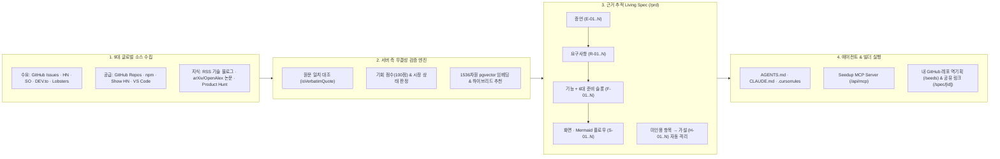

<div align="center">

# 🌱 Seedup

**세상의 실제 개발자 불만(Pain Point)과 최신 기술 신호를 원문 단위로 교차 검증해,**  
**근거 추적형 기획서(Living Spec)와 코딩 에이전트 지침(`AGENTS.md` · MCP)까지 한 번에 이어주는 프로덕트 인텔리전스 플랫폼**

[](https://seedup.rerereally.com)
[](https://nextjs.org/)
[](https://react.dev/)
[](https://supabase.com/)
[](https://modelcontextprotocol.io/)
[](https://seedup.rerereally.com)

</div>

---

## 👥 참여 인원 (Team)

| 이름 | 역할 및 담당 |
| :---: | :--- |
| **정지훈** | 프로젝트 총괄 설계 · 기회 엔진 & Living Spec(`E→R→F→S`) · RAG/추천 파이프라인 · MCP 서버 · 풀스택 개발 |
| **장차희** | 서비스 기획 · 데이터 검증 및 큐레이션 설계 · UI/UX 개선 및 품질 테스트 |

---

## 💡 왜 Seedup을 만들었는가? (Why Seedup?)

> *"코딩 에이전트(Cursor, Claude Code) 덕분에 **'어떻게 코딩할까(How to code)'**는 10배 빨라졌습니다. 하지만 정작 **'무엇을, 왜 만들어야 의미가 있는가(What & Why to build)'**에서는 내 머릿속 아이디어가 고갈되어 뻔한 토이 프로젝트만 반복하고 있었습니다. LLM에게 물어봐도 무조건 좋은 아이디어라고 아부(Sycophancy)하거나 없는 근거를 지어내는(Hallucination) 한계를 넘어, **전 세계 개발자들이 실제로 겪고 있는 고통(원문 증언)에서 출발해 검증된 설계도와 에이전트 지침까지 한 호흡으로 이어주는 시스템**을 만들고자 Seedup을 개발했습니다."*

### 기존 서비스들과의 결정적 차별점

| 비교 영역 | 기존 뉴스레터 · 트렌드 서비스 | 기존 AI PRD · 아이디어 생성 툴 | **🌱 Seedup만의 차별점** |
| :--- | :--- | :--- | :--- |
| **근거 검증** | 단일 매체 요약, 읽고 북마크만 쌓인 채 휘발됨 | 사용자의 짧은 프롬프트만 보고 그럴듯한 소설형 PRD 생성 | **100% 원문 글자 대조(`isVerbatimQuote`)**: 실제 게시글 원문에 존재하는 증언만 채택하고, 근거 없는 요구사항은 서버가 강제로 **`가설(H-n)`**로 분리 |
| **시장 공급 대조** | 시장 경쟁 상황 분석 없음 | 이미 GitHub 스타 2만 개짜리 오픈소스가 있어도 칭찬만 함 | **수요 5대 플랫폼 × 공급 4대 채널 교차 확인**: 기존 오픈소스·패키지 유무와 첫 불만 이후 후발 도구 등장 시차(`trackRecord`)까지 정량 산출 |
| **스펙 구조 & 코딩 연결** | 읽기(Reading)에서 끝남 | 정적 마크다운 텍스트 1장 출력 후 끝남 | **`증언(E) → 요구사항(R) → 기능(F) → 화면(S)` 양방향 추적 + 6대 개발 준비 슬롯 + `AGENTS.md` / `CLAUDE.md` / `.cursorrules` + MCP 서버 직결** |
| **기존 프로젝트 성장** | 지원 안 함 | 새 창업 아이템만 다룸 | **내 씨앗(`/seeds`) 역기획(Reverse Spec)**: 내 GitHub 공개 레포의 기존 구조를 분석해 깨지 않는 선에서 **다음 기능 3가지(GitHub Issue 생성) + 최신 논문 + 역기획 스펙** 제안 |

---

## 🏗️ 핵심 아키텍처 & 근거 추적 파이프라인



---

## 🚀 주요 기능 명세 (Core Features)

### 1. 인터랙티브 홈 스테이지 & 하이브리드 실시간 매칭 (`/`)
- **Matter.js 2D 물리 증언 칩 파일**: 실제 개발자 불만 인용문들이 물리 엔진(중력·충돌·쿠션 안착)으로 반응하며, 클릭해 내 근거 바구니에 수집 (`prefers-reduced-motion` 환경에서는 정적 그리드로 자동 전환)
- **하이브리드 실시간 기회 매칭 (`POST /api/opportunities/match`)**: 타이핑 즉시 반응하는 로컬 토큰 매칭 + 450ms 디바운스 후 동작하는 1536차원 임베딩 코사인 유사도 매칭
- **실시간 근거 확인서 (`EvidenceCertificate`)**: 최소 증언 3건 + 플랫폼 2종 충족 여부를 실시간 판정하고, 영어 원문·한국어 번역·원문 링크·`원문 일치` 검증 배지를 표시하며 전용 PRD 워크스페이스(`/prd`)로 즉시 연결

### 2. 기회 엔진 & 선행 적중 기록 (`/opportunities`, `/opportunities/[slug]`)
- **5대 수요 액터 × 4대 공급 채널 교차 수집**:
  - **수요(Demand)**: GitHub Issues, Hacker News(Ask HN/댓글), Stack Overflow, DEV.to, Lobsters
  - **공급(Supply)**: GitHub Repositories, npm Registry, Show HN, VS Code Marketplace
- **원문 대조 검증 (`isVerbatimQuote`)**: LLM이 뽑은 인용문이 실제 원문 텍스트에 15자 이상 정규화 부분 문자열로 포함될 때만 통과시켜 환각(Hallucination) 인용을 원천 차단
- **100점 만점 기회 점수 & 시장 상태 분류**: 수요 강도(40점) + 공급 빈틈(35점) + 최근성(25점) 정량 계산 및 직접 경쟁 수·스타 수 기반 시장 상태(`open` / `narrowing` / `closed` / `unknown`) 자동 판정
- **Why Now 타이밍 분석 & 선행 적중 기록 (`trackRecord`)**: 최근 30일/90일 신호 집중도 분석 및 첫 불만 포착일(`firstSeenAt`) 이후 실제로 등장한 후발 도구 수(`followersAfterSignal`)와 선행 기간 막대 시각화
- **복수 기회 맥락 병합 (`lib/opportunities/context.ts`)**: 서로 다른 기회에서 모은 증언들을 조합할 때 모든 관련 기회의 문제 정의·시장 빈틈·경쟁 도구를 중복 없이 병합

### 3. 근거 추적형 Living Spec 워크스페이스 (`/prd`, `/spec/[id]`)
- **4단계 양방향 근거 추적 (`E-n → R-n → F-n → S-n`, `lib/opportunities/spec.ts`)**:
  - 모든 요구사항(`R-01`)은 수집된 증언 번호(`E-1`)를 인용해야 하며, 기능(`F-01`)은 요구사항을, 화면(`S-01`)은 기능을 참조하도록 서버 `normalizeSpec()`에서 강제 검증
  - 증언 근거가 없는 요구사항은 자동으로 **`검증 필요 가설(H-01)`**로 격리하고, 기준 미달 기회는 **`가설 초안(Hypothesis draft)`** 배지를 부여해 정직하게 생성
  - 화면에서 임의의 노드를 클릭하면 연결된 원문 증언과 상위·하위 기능/화면 사슬이 동시에 하이라이트(`traceOf`)
- **6대 개발 준비 슬롯 (`ReadinessSlots`, `POST /api/opportunities/prd/slots`)**:
  - 각 기능(`F-n`)마다 코딩 에이전트가 추측 없이 구현할 수 있도록 **① 입력·상태 조건(`inputs`), ② 비즈니스 규칙(`rules`), ③ 예외·오류 처리(`errors`), ④ 권한·접근 제어(`access`), ⑤ 데이터·스키마 요건(`data`), ⑥ 테스트·완료 기준(`done`)** 6개 슬롯을 생성 (미정 항목은 에이전트가 먼저 질문하도록 명시)
- **4종 멀티뷰 & 대화형 부분 수정 (`POST /api/opportunities/prd/revise`)**:
  - **근거 추적(Trace) / 구조 트리(IA Tree) / 유저플로우(Mermaid Flowchart) / 마크다운 문서(Document)** 4가지 뷰를 단일 `Spec` 상태에서 실시간 전환
  - 원문 증언 목록은 불변으로 고정한 채 자연어 지시문으로 기획서를 수정하고, 변경된 항목 수 표시 및 **1단계 되돌리기(`undo`)** 지원
- **3종 코딩 에이전트 포맷 내보내기 & 공개 공유 링크 (`/spec/[id]`)**:
  - **`AGENTS.md` · `CLAUDE.md` · `.cursorrules`** 3종 에이전트 브리프 및 PRD 마크다운 복사/다운로드 지원
  - 보관함(`/scrap`)에 저장한 PRD는 소유자 토글 하나로 **읽기 전용 공개 공유 링크(`/spec/[id]`)**를 생성해 팀원·심사위원과 즉시 공유 가능

### 4. 내 씨앗 — GitHub 저장소 어드바이저 & 역기획 (`/seeds`)
- **공개 저장소 자동 분석 & 배치 동시 처리**: GitHub 계정 또는 OAuth 연동 시 최근 비포크(non-fork) 공개 저장소들의 설명·언어·토픽·`README.md`를 분석하고 3개 단위 배치 큐로 빠르게 결과 렌더링
- **맞춤형 기회·아티클·오픈소스 매칭**: 저장소 임베딩과 키워드를 대조해 가장 가까운 기회 신호 및 관련 아티클·유사 오픈소스를 자동 연결하고 재방문 시 `새 신호` 배지 표시
- **다음 기능 3가지 제안 & GitHub Issue 즉시 열기**: 저장소 맥락과 시장 불만 신호를 결합해 다음 릴리즈 기능 3가지를 제안하고, 마크다운 복사뿐 아니라 **해당 저장소의 `issues/new` 페이지로 제목·본문을 채워 바로 여는 원클릭 버튼** 제공
- **내 레포 역기획 (`Reverse Spec`)**: 선택한 저장소의 `README.md`, 상위 2단계 파일 트리, `package.json`/`pyproject.toml` 매니페스트를 분석해 **기존 구조(`existing` IA — 새 기능이 깨면 안 되는 것)**를 보존하면서 시장 증언과 연결된 새 기능 Living Spec을 생성
- **arXiv + OpenAlex 이중 폴백 논문 추천**: 저장소 주제에 맞는 최신 학술 논문 최대 3편 추천

### 5. Seedup MCP 서버 — Claude Code · Cursor 직결 (`/api/mcp`, `/profile`)
- **표준 Streamable HTTP JSON-RPC 2.0 서버 (`lib/mcp/server.ts`)**: 외부 무거운 의존성 없이 Cloudflare Workers 환경에서 즉시 동작하는 경량 MCP 서버 구현
- **프로필 개인 토큰 관리 (`components/McpConnect.tsx`)**: `/profile`에서 개인용 `sdup_...` 토큰 발급/폐기(DB에는 SHA-256 해시만 저장) 및 원클릭 연결 명령어 복사
- **4대 제공 도구 (`TOOLS`)**:
  1. `search_opportunities`: 검증된 개발자 불만 기회 키워드 검색
  2. `get_opportunity`: 특정 기회의 문제·시장 빈틈·원문 증언(`E-n`)·직접 경쟁 도구 상세 조회
  3. `generate_verified_prd`: 근거 추적형 스펙을 `AGENTS.md`, `CLAUDE.md`, `.cursorrules`, `PRD` 포맷으로 즉시 생성 (동일 근거 캐시 히트 시 일일 한도 미차감)
  4. `find_related_content`: 아이디어와 의미적으로 가까운 수집 뉴스·논문·레포·제품 검색

### 6. AI 아이디어 검증기 & pgvector 하이브리드 RAG (`/ideas`)
- **사전 입력 검증 (`validateIdeaInput`)**: 최소 글자 수, 자모 연타, 비속어, 무의미 입력을 LLM 호출 전 필터링
- **하이브리드 RAG 근거 검색 (`retrieveIdeaContext`)**: Supabase `content_embeddings`(1536차원 `pgvector`) 코사인 유사도와 키워드 오버랩으로 관련 뉴스·논문·오픈소스·AI 제품 근거 검색
- **다차원 평가 리포트 (`EvaluationPanel`)**: 종합 점수(100점)·시장성·실현 가능성 산출, **사용자 명시 내용(`user_stated`) vs AI 추정 가정(`inferred_assumptions`) 분리**, RAG 근거 수 기반 서버 측 신뢰도(`높음/보통/낮음`) 강제 보정, 평가 결과 **보관함 저장 및 다시 열기(`/ideas?evaluation=<id>`)** 지원

### 7. 멀티소스 기술 아티클 · 논문 심층 리뷰 · 글 도우미 챗봇 (`/news`, `/papers/[id]`)
- **6개 데일리 아티클 트랙 & 주간 Deep Dive**: `AI/LLM`, `프론트엔드`, `백엔드`, `오픈소스/GitHub`, `제품/빌드 아이디어`, `논문/리서치` 트랙별로 최소 3개 이상 원문 소스 & 2종 이상 소스 타입이 모인 클러스터만 발행
- **문장별 주장 출처 분류 (`article_claims`)**: 아티클 내 핵심 주장을 `원문 근거(source)`, `추론(inference)`, `배경지식(general_knowledge)`으로 분류 및 원문 링크 연결
- **우측 플로팅 글 도우미 챗봇 (`ArticleAssistant`)**: 아티클·논문·프로젝트 상세 우측에서 본문 컨텍스트를 기반으로 전체 대화 맥락을 유지하며 핵심 요약·용어 설명·실무 적용 질의응답 (`POST /api/articles/ask`)

### 8. 개인화 추천 · 이중 뉴스레터 · 한/영(`KO/EN`) 다국어 · 관리자 관제
- **단일 통합 스코어링 엔진 (`lib/recommendations.ts`)**: 온보딩 프로필(관심사, 목표, 희망 직무, 선호 스택, 개발 수준, 선호 섹션) + 사이트 행동 데이터(스크랩·좋아요 가산, 싫어요 제외) + 시간 경과에 따른 신선도 감쇠(`freshnessPoints`)를 결합하고, 3글자 이하 짧은 영단어(`ai`, `ui`, `go`, `db`)의 단어 경계 오매칭을 방지
- **이중 뉴스레터 발송 (Resend + 개별 수신자 격리 & 멱등성 보장)**:
  - 개인 맞춤형 주간 리딩 뉴스레터(`app/actions/newsletter.ts`) 및 개인 관심사·스크랩 기반 기회 변동/주간 다이제스트(`lib/newsletter/opportunity-digest-send.ts`) 발송
  - 수신자별 예외 격리 및 `newsletter_sends` 테이블 + Resend `Idempotency-Key`로 중복 발송 차단
- **한국어 / 영어(`KO/EN`) 다국어 지원 (`lib/i18n.ts`, `components/LangProvider.tsx`)**: 헤더 토글 하나로 홈, 기회 목록·상세, PRD 워크스페이스, 생성되는 PRD·슬롯·수정·역기획 결과까지 한국어/영어 전환
- **관리자 데이터 수집·관제 콘솔 (`/admin/ingest`)**: 11단계 수집·집계·생성·임베딩 백필(`/api/ingest/embeddings`) 제어, 단계별 성공/실패 리포팅, 기회 다이제스트 미리보기 및 발송, 소스별 승인율·품질 미달 로그(`ingest_rejections`) 모니터링

---

## 🛠️ 기술 스택 (Tech Stack)

| 영역 | 사용 기술 |
| :--- | :--- |
| **Frontend & Framework** | Next.js 16 (App Router), React 19, TypeScript, Tailwind CSS 4 |
| **Interactive UI** | Matter.js (2D 물리 엔진), Mermaid (유저플로우 다이어그램), Lucide React |
| **Backend & Database** | Supabase PostgreSQL, Row Level Security (RLS), `pgvector` (1536차원 임베딩) |
| **Authentication** | Supabase Auth (Google OAuth, GitHub OAuth), SHA-256 Personal MCP Tokens |
| **AI & Embeddings** | OpenRouter API (LLM 생성·전처리·검증·역기획 및 `openai/text-embedding-3-small` 임베딩) |
| **Data Collectors** | `rss-parser`, GitHub REST API, Hacker News Algolia API, Stack Exchange API, DEV.to API, Lobsters, npm Registry, VS Code Marketplace, arXiv API, OpenAlex API |
| **Agent Integration** | Model Context Protocol (MCP, Streamable HTTP JSON-RPC 2.0), `AGENTS.md` / `CLAUDE.md` / `.cursorrules` |
| **Email & Cron** | Resend API (`newsletter_sends` 멱등성 보장), GitHub Actions Scheduled Workflows |
| **Deployment** | Cloudflare Workers, `@opennextjs/cloudflare` (Smart Placement) |

---

## ⚡ 빠른 시작 및 설치 (Getting Started)

### 1. 사전 요구사항
- **Node.js** 20.9 이상 / **npm** 10 이상
- **Supabase** 프로젝트 (`pgvector` 확장 활성화)
- **OpenRouter** API 키
- *(선택)* GitHub Personal Access Token, Google/GitHub OAuth 클라이언트, Resend API 키

### 2. 클론 및 패키지 설치

```bash
git clone https://github.com/rerereally/Seedup_ver2.git
cd Seedup_ver2
npm install
cp .env.example .env
```

### 3. 환경변수 설정 (`.env`)

`.env.example`을 복사한 `.env` 파일에 아래 필수 값을 입력합니다.

```env
# Supabase
NEXT_PUBLIC_SUPABASE_URL=https://your-project.supabase.co
NEXT_PUBLIC_SUPABASE_PUBLISHABLE_KEY=sb_publishable_your-key
SUPABASE_SECRET_KEY=sb_secret_your-key

# OpenRouter (LLM & Embedding)
OPENROUTER_API_KEY=your-openrouter-api-key
OPENROUTER_MODEL=nvidia/nemotron-3.5-super-vl:free
OPENROUTER_FALLBACK_MODELS=openrouter/free
RAG_EMBEDDING_MODEL=openai/text-embedding-3-small

# Site & Admin Security
NEXT_PUBLIC_SITE_URL=http://localhost:3000
INGEST_SECRET=change-this-secret
ADMIN_EMAILS=you@example.com
```

<details>
<summary><b>선택 환경변수 전체 보기 (GitHub, Resend, 수집 옵션 등)</b></summary>

```env
GITHUB_TOKEN=your-github-token
GITHUB_MIN_STARS=50
HUGGINGFACE_TOKEN=your-huggingface-token
STACKEXCHANGE_KEY=your-stackexchange-key

RESEND_API_KEY=your-resend-api-key
NEWSLETTER_FROM_EMAIL="Seedup <newsletter@your-domain.com>"

OPENROUTER_TIMEOUT_MS=45000
OPENROUTER_ARTICLE_TIMEOUT_MS=75000
MAX_ITEMS_PER_SOURCE=10
RSS_RECENT_WINDOW_DAYS=7
INGEST_OPENROUTER_MODEL_LIMIT=20
CRON_SECRET=optional-cron-secret
INGEST_INTERNAL_URL=http://localhost:3000
```
</details>

### 4. 데이터베이스(Supabase) 설정

Supabase Dashboard의 **SQL Editor**에서 아래 파일들을 실행합니다.
1. **초기 전체 스키마**: [supabase/schema.sql](supabase/schema.sql) (신규 프로젝트는 이 파일에 전체 테이블·인덱스·RLS가 포함되어 있습니다)
2. **운영 중 프로젝트 증분 마이그레이션**:
   - [supabase/opportunities_2026_11.sql](supabase/opportunities_2026_11.sql): 기회 엔진(`opportunities`) 및 증언 도시에(`evidence_dossiers`)
   - [supabase/hardening_2026_11.sql](supabase/hardening_2026_11.sql): 일일 AI 호출 쿼터(`daily_usage_limits`, `consume_daily_usage` RPC) 및 RLS 강화
   - [supabase/view_count_2026_11.sql](supabase/view_count_2026_11.sql): 상세 페이지 조회수 원자적 증가(`increment_content_view` RPC)
   - [supabase/usage_refund_2026_11.sql](supabase/usage_refund_2026_11.sql): LLM 생성 실패 시 일일 쿼터 즉시 반환(`release_daily_usage` RPC)
   - [supabase/mcp_tokens_2026_11.sql](supabase/mcp_tokens_2026_11.sql): 개인용 MCP 토큰(`mcp_tokens`) 테이블 및 RLS
   - [supabase/prd_cache_2026_11.sql](supabase/prd_cache_2026_11.sql): 동일 증언 조합 PRD 캐시 조회용 인덱스(`evidence_dossiers_cache_idx`)
   - [supabase/dossier_share_2026_11.sql](supabase/dossier_share_2026_11.sql): 보관함 PRD 공개 공유 링크(`/spec/[id]`) 컬럼 및 정책
   - [supabase/newsletter_sends_2026_11.sql](supabase/newsletter_sends_2026_11.sql): 뉴스레터 및 다이제스트 중복 발송 방지(`newsletter_sends`)
3. **OAuth Redirect URL 등록** (`Authentication > URL Configuration`):
   - `http://localhost:3000/auth/callback`
   - `https://seedup.rerereally.com/auth/callback`

### 5. 로컬 실행 및 검증

```bash
# 개발 서버 실행 (http://localhost:3000)
npm run dev

# 타입 검사 · 린트 · 단위 테스트(66개) · 프로덕션 빌드
npm run typecheck
npm run lint
npm test
npm run build

# 주요 화면 및 API 응답 스모크 테스트
SMOKE_BASE_URL=http://localhost:3000 npm run smoke
```

---

## 🔌 MCP 서버 연결 가이드 (Claude Code · Cursor)

Seedup은 코딩 에이전트에서 바로 검증된 기회를 검색하고 근거 추적형 PRD(`AGENTS.md`, `CLAUDE.md`, `.cursorrules`)를 가져올 수 있도록 **MCP 서버(`/api/mcp`)**를 제공합니다.

1. 사이트 로그인 후 **`프로필(/profile) → MCP 연결`**에서 개인 토큰(`sdup_...`)을 발급받습니다.
2. **Claude Code**에서 아래 명령 한 줄로 연결합니다:
   ```bash
   claude mcp add --transport http seedup https://seedup.rerereally.com/api/mcp \
     --header "Authorization: Bearer <발급받은_토큰>"
   ```
3. 에이전트에게 바로 지시할 수 있습니다:
   > *"Seedup에서 에이전트 메모리 관련 기회를 찾아서 검증된 `AGENTS.md` 스펙을 생성하고 첫 번째 기능 `F-01`부터 구현해 줘."*

---

## 🔄 데이터 수집 · 기회 엔진 · 뉴스레터 실행

### 1. 기회 엔진 실행 (`lib/opportunities/`)
```bash
# 로컬 스냅샷(lib/opportunities/snapshot.ts) 갱신
npm run engine

# 스냅샷 갱신 + Supabase opportunities 테이블 게시
npm run engine -- --persist
```

### 2. 멀티소스 데이터 수집 & RAG 임베딩 동기화 (`/api/ingest/*`)
관리자 계정으로 `/admin/ingest`에서 실행하거나, `x-ingest-secret` 헤더로 API를 직접 호출합니다(보안상 URL 쿼리 파라미터 비밀값은 허용하지 않습니다).

```bash
BASE_URL=http://localhost:3000
SECRET=YOUR_INGEST_SECRET

# 전체 파이프라인(수집 → 집계 → 아티클/아이디어 생성 → 임베딩 동기화) 일괄 실행
curl -X POST -H "x-ingest-secret: $SECRET" "$BASE_URL/api/ingest/all"

# 누락된 RAG 임베딩만 별도 백필
curl -X POST -H "x-ingest-secret: $SECRET" "$BASE_URL/api/ingest/embeddings?perSource=1000&max=200"
```

### 3. 기회 다이제스트 이메일 발송
```bash
npx tsx --env-file=.env scripts/send-opportunity-digest.ts --mode=changes
npx tsx --env-file=.env scripts/send-opportunity-digest.ts --mode=weekly
```

---

## 📂 프로젝트 폴더 구조 (Directory Structure)

```text
app/
  page.tsx                    인터랙티브 홈 스테이지 (OpportunityStage & 기회 퍼널 테이블)
  opportunities/              기회 탐색 목록 및 상세 (점수 · Why Now · 선행 적중 기록)
  prd/                        풀폭 근거 추적형 Living Spec 워크스페이스 (/prd)
  spec/[id]/                  보관함 PRD 읽기 전용 공개 공유 페이지 (/spec/[id])
  seeds/                      내 GitHub 저장소 어드바이저 & 역기획 (/seeds)
  ideas/                      AI 아이디어 평가 & pgvector RAG 리포트 (/ideas)
  news/                       멀티소스 아티클 목록 · 상세 · 문장별 출처 표시
  papers/                     논문 심층 리뷰 상세
  trends/                     9대 소스 트렌드 랭킹 & 모델 인텔리전스 리더보드
  projects/                   실전 프로젝트 빌드 플랜 상세
  ai-products/                AI 제품 레이더 · 별점 · 사용자 리뷰
  github-trends/              GitHub 급상승 오픈소스 상세
  scrap/                      통합 보관함 (PRD 열람 · 복사 · 공개 링크 토글 · 삭제)
  search/                     태그 배열 포함 통합 DB 검색
  onboarding/ & profile/      사용자 관심사 온보딩, 프로필 및 MCP 토큰 발급
  admin/ingest/               관리자 데이터 수집 · 다이제스트 · 품질 관제 콘솔
  api/
    opportunities/            기회 실시간 매칭, Living Spec 생성·슬롯·수정, 도시에 API
    mcp/                      MCP JSON-RPC 2.0 서버 (/api/mcp) 및 토큰 발급 API
    seeds/                    GitHub 저장소 분석, 기능 제안, 논문 추천, 역기획 API
    ideas/evaluate/           하이브리드 RAG 아이디어 평가 API
    articles/ask/             본문 컨텍스트 질의응답 챗봇 API
    ingest/                   RSS, 제품, GitHub, 논문, 트렌드, 아티클, 임베딩 수집 API
components/
  opportunity-stage/          Matter.js 칩 파일, 근거 확인서, Living Spec 빌더 (PrdBuilder)
  SeedAdvisor.tsx             GitHub 저장소별 기회 · 기능 · 논문 · 역기획 UI
  DossierPrd.tsx              보관함 PRD 뷰어, 에이전트 브리프 다운로드, 공개 공유 토글
  McpConnect.tsx              프로필 MCP 토큰 발급 및 Claude Code/Cursor 설정 안내
  ArticleAssistant.tsx        우측 플로팅 아티클 도우미 챗봇
  LangProvider.tsx            한국어/영어(KO/EN) 언어 전환 컨텍스트
lib/
  opportunities/              기회 액터, 원문 검증(rules.ts), Living Spec(spec.ts), PRD 생성·캐시
  mcp/                        MCP 서버(server.ts) 및 SHA-256 토큰 인증(auth.ts)
  seeds/                      GitHub 공개 레포 구조 조회, 기회 매칭, 기능 제안, 논문 검색
  ingest/                     AI 전처리, pgvector RAG, 수집 스텝, 상수 시간 시크릿 검증
  newsletter/                 맞춤형 주간 뉴스레터 및 개인화 기회 다이제스트 렌더러
  recommendations.ts          통합 개인화 추천 점수 엔진 (행동 신호 · 신선도 · 오매칭 방지)
  usage-limit.ts              원자적 일일 AI 쿼터 차감 및 실패 시 자동 환불
  i18n.ts & i18n-server.ts    한/영 번역 헬퍼 및 서버 쿠키 로더
supabase/                     전체 스키마(schema.sql) 및 기능별 마이그레이션 SQL
tests/                        단위 및 통합 검증 테스트 (66개 테스트 케이스)
```

---

## ☁️ Cloudflare Workers 배포

`main` 브랜치 푸시 시 GitHub Actions(`.github/workflows/ci.yml`)가 `typecheck → lint → test → build` 검증 후 Cloudflare Workers로 배포합니다. 수동 배포 및 로컬 프리뷰는 아래 명령을 사용합니다.

```bash
npm run preview   # OpenNext Cloudflare 로컬 미리보기
npm run deploy    # Cloudflare Workers 프로덕션 배포
```

---

<div align="center">

**Seedup** — *Stop guessing what to build. Start from verified developer pain.*  
Built by **정지훈 (Jeong Jihun)** & **장차희 (Jang Chahee)**

</div>
